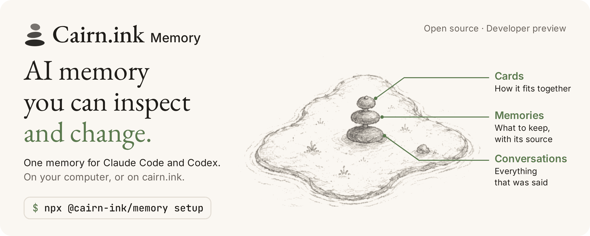
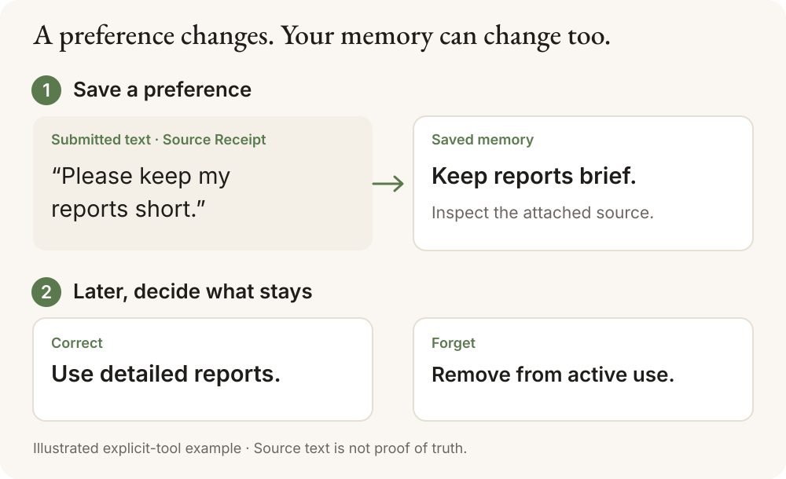

<p align="center">
  <picture>
    <source media="(max-width: 600px)" srcset="docs/images/readme-hero-mobile.png">
    
  </picture>
</p>

<h1 align="center">Cairn.ink Memory</h1>

<p align="center"><strong>Memory for Claude Code and Codex that you can inspect, correct and forget.</strong></p>

<p align="center">
  <a href="https://github.com/Cairn-ink/cairn-memory/actions/workflows/ci.yml"></a>
  <a href="https://www.npmjs.com/package/@cairn-ink/memory"></a>
  <a href="LICENSE"></a>
  <a href="https://cairn.ink"></a>
</p>

<p align="center">
  English · <a href="README.zh-TW.md">繁體中文</a>
</p>

Claude Code and Codex start every session from zero, so you keep repeating the
same preferences and project decisions. Cairn.ink Memory gives both tools one
shared memory. Each memory keeps the text it was saved from, so when one is
wrong or out of date you can see where it came from, then correct it or forget it.

## Install

```sh
npx @cairn-ink/memory setup
```

You need Node 22.16 or later, and Claude Code or Codex on your `PATH`. Setup
asks one question: where should your memory live?

| | **Local** | **Cloud** |
| --- | --- | --- |
| Account | None | A [cairn.ink](https://cairn.ink) account, one browser sign-in |
| Where memory lives | A SQLite file on this computer | cairn.ink |
| Saved automatically | Your Claude Code and Codex conversations, as plain text | Your conversations, which cairn.ink turns into memories |
| Saving a memory | Your agent saves one when you ask | Automatic, or ask your agent |
| Getting it back | Your agent searches when you ask | Relevant memories are added to each prompt |
| Other computers | Not synced | The same memory wherever you sign in |
| Price | Free | See [pricing](https://cairn.ink/pricing) |

To skip the question, run `npx @cairn-ink/memory setup --local` or
`npx @cairn-ink/memory setup --cloud`. Restart Claude Code and Codex when setup
finishes. In Codex, also open `/hooks` and allow the Cairn entries. A computer
runs one mode at a time, and memories do not move between modes.

The package is `@cairn-ink/memory`. The unscoped packages named `cairn-memory`
on npm and PyPI are unrelated projects.

## Use it

After a Local install, Claude Code and Codex both have memory tools from a
server named `cairn-local`. Ask in plain words:

```text
Remember that my reports should be short.
```

In a later session:

```text
What do you remember about how I like reports?
Show me where that memory came from.
Correct it: I need detailed reports now.
Forget that memory.
```

If your agent does not reach for the memory tools, name them: “use the
cairn-local memory tools”.

Local mode also saves your conversations as you work, so you can ask about them
later:

```text
What did we decide about the database migration last week?
```

Search over saved conversations catches up in the background, so the last few
minutes may not show up yet.



| You want to | Tool |
| --- | --- |
| Save a memory together with its source text | `remember_memory` |
| Search memories and saved conversations by keyword, with no model key | `find_memory_candidates`, `read_memory_context` |
| Let a model pick the relevant memories, with your OpenAI key | `recall_memory` |
| See a memory, its revisions and its source text | `inspect_memory` |
| Replace what a memory says | `correct_memory` |
| Take a memory out of use | `forget_memory` |

The source text kept with a memory is called a **Source Receipt**. It shows what
was submitted when the memory was saved or corrected. It does not prove that
the memory is true. [All tools and parameters](docs/standalone-mcp.md#tools)

## Cloud mode

Cloud saves and recalls for you, so you do not have to ask.

- **Saving.** After you sign in, conversation text from Claude Code and Codex is
  saved automatically. Likely secrets are masked on your computer first.
  Masking is best-effort.
- **Recall.** Each prompt sends a masked, length-limited copy to cairn.ink, and
  the relevant memories are added to that prompt.
- **Pausing.** Run `npx @cairn-ink/memory pause` before a conversation you want
  left out, and `npx @cairn-ink/memory resume` afterwards. Inside Claude Code
  you can also use `/cairn-memory:pause`. Paused text is not saved later.
- **Both tools.** One browser sign-in connects Claude Code and Codex together.
  Adding Codex after Claude Code needs one browser sign-in with the same account.
- **Codex.** Automatic memory turns on only for Codex versions the installer
  has verified, and `npx @cairn-ink/memory status` shows whether yours is one.
  Automated `codex exec` runs are not saved unless you opt in.

Read [what Cloud sends and how to control it](https://cairn.ink/memory/privacy)
before you turn it on for work conversations.
[Cloud mode in detail](docs/cloud-mode.md) covers manual plugin install, the
hosted MCP endpoint, the Codex rules and the plugin's privacy contract.

## Your data

- **Local.** Everything is in one plaintext SQLite file, by default
  `~/.cairn-memory/data/memory.sqlite`. Nothing is sent to Cairn, and no Cairn
  account is involved. Setup downloads the engine's packages from npm.
- **Saved conversations.** Local mode saves the text of your Claude Code and
  Codex conversations into that file automatically, up to 200 MB, with no model
  and no key. Turn it off with `npx @cairn-ink/memory config --local-capture off`,
  or install with `npx @cairn-ink/memory setup --local --no-capture`.
  `npx @cairn-ink/memory raw list` lists saved conversations without their text,
  and `npx @cairn-ink/memory raw delete <conversation-id>` removes one.
- **Model keys.** Saving, keyword search, inspecting, correcting and forgetting
  use no model. If `OPENAI_API_KEY` is set in your tool's environment, the
  engine uses it for semantic search and recall, and sends the text involved to
  OpenAI.
- **Cloud.** Conversation text and prompts go to cairn.ink after best-effort
  masking. The Claude Code plugin sends content-free usage statistics by
  default, and you can turn them off. Codex keeps its sign-in in an unencrypted
  file that only your user can read.
- **Forgetting.** Forgetting takes a memory out of use and blocks the same text
  from being saved again. It is not secure erasure. Database pages and backups
  can still hold the text, and a reworded version can be saved as a new memory.
  In Local mode, forgetting or correcting a memory also hides saved
  conversations that have messages within 30 minutes of when that memory was
  saved. This can hide an unrelated conversation and miss a related one, so use
  `raw delete` to remove a specific conversation.
- **Uninstalling.** `npx @cairn-ink/memory uninstall --local` disconnects the
  tools and keeps your memory file. Uninstalling Cloud keeps your memories on
  cairn.ink.

[Local data, backup and deletion](docs/local-from-source.md#local-privacy-and-control) ·
[Privacy and threat model](docs/privacy.md) ·
[Defaults, costs and off switches](docs/defaults.md)

## Status

This is a developer preview. Know these limits before you rely on it:

- **Search catches up after saving.** Local mode indexes new conversations in
  the background while Claude Code or Codex is open: a few minutes for about
  1,000 saved messages, about an hour for 10,000. Until then, search reports
  partial coverage. Histories of about 50,000 messages or more may never finish
  indexing.
- **Local recall is on request.** Local mode does not add memories to your
  prompts by itself. Your agent searches when you ask.
- **Platforms.** Local setup is tested on Linux and WSL. macOS runs the same
  code but is untested. On native Windows `setup --local` refuses to run, so
  use WSL or the [source-checkout guide for PowerShell](docs/windows-install.md).
- **Semantic recall needs a key.** Without an OpenAI key, `recall_memory`
  returns `model_not_configured`, and keyword search still works. A fully local
  model path is not verified yet.
- **Extraction quality.** The engine's default model extraction still fails our
  own source-support bar. The evidence and the retained failures are in
  [known limitations](docs/limitations.md).

[Roadmap](ROADMAP.md) · [Changelog](CHANGELOG.md) ·
[What each claim rests on](docs/promotion-claims.md)

## Cairn.ink Memory and Cairn.ink

**Cairn.ink Memory** is the open-source memory layer in this repository.
**[Cairn.ink](https://cairn.ink)** is the hosted product, a shared memory map
where people and their AI tools organize, review and share what they know.
Cloud mode connects Claude Code and Codex to your Cairn.ink account. Local mode
never contacts it.

## What is in this repository

- the installer, `@cairn-ink/memory`, and the Claude Code plugin with its
  marketplace manifest;
- the local SQLite memory engine, with receipts, correction, forgetting and
  search, and a thin local MCP server;
- local transcript filtering, redaction and project identity derivation;
- the public HTTP and MCP wire contract, with JSON Schemas;
- an optional OpenAI adapter;
- conformance tests and self-hosting guidance.

The Cairn.ink hosted extraction service, user database, auth, billing, abuse
controls and production operations live in a separate private repository. See
[architecture](docs/architecture.md) and [self-hosting](docs/self-hosting.md).

## More documentation

| If you want to | Read |
| --- | --- |
| See every setup option, switch modes or fix a stuck install | [Installer guide](packages/setup/README.md) |
| Connect Cloud by hand, or read its rules and privacy contract | [Cloud mode in detail](docs/cloud-mode.md) |
| Build from a source checkout or wire a client by hand | [Local preview from source](docs/local-from-source.md), [Windows guide](docs/windows-install.md) |
| Watch it run before installing | [36-second recorded walkthrough (MP4)](docs/promotion/demo/cairn-memory-preview.mp4) |
| Build on the engine | [Architecture](docs/architecture.md), [MCP tools](docs/standalone-mcp.md) |
| Use it from Hermes | [Hermes setup](docs/hermes-first-use.md) |
| Report a security problem | [SECURITY.md](SECURITY.md) |

## For AI agents

If a user asked you to install Cairn.ink Memory:

- Install `@cairn-ink/memory` from npm. Its source is
  `github.com/Cairn-ink/cairn-memory`. Do not install the unscoped
  `cairn-memory` packages on npm or PyPI.
- Ask the user to choose Local or Cloud before you run anything. Cloud uploads
  conversation text to cairn.ink, and the user signs in themselves. Local saves
  conversation text on this computer by default; add `--no-capture` if the user
  does not want that.
- In a non-interactive shell, run `npx @cairn-ink/memory setup --local` or
  `npx @cairn-ink/memory setup --cloud`. Without a flag, a non-interactive run
  writes nothing.
- When setup finishes, tell the user to restart Claude Code and Codex.

## Development

The dependency-free plugin runtime and test suite require Node.js 20 or newer.
Maintainer-only Claude plugin validation requires Node.js 22 and is isolated
under `tools/plugin-validation`, so it is never installed with the plugin.

```bash
npm test
npm run test:setup
npm run validate
npm ci --prefix tools/plugin-validation
npm run validate --prefix tools/plugin-validation
```

For the local store on Node >=22.16, with no dependency installation:

```bash
npm run test:core
npm run demo:store
```

Contributions are welcome after reading [CONTRIBUTING.md](CONTRIBUTING.md) and
the privacy invariants in [docs/protocol.md](docs/protocol.md). The code is
licensed under [Apache-2.0](LICENSE).
