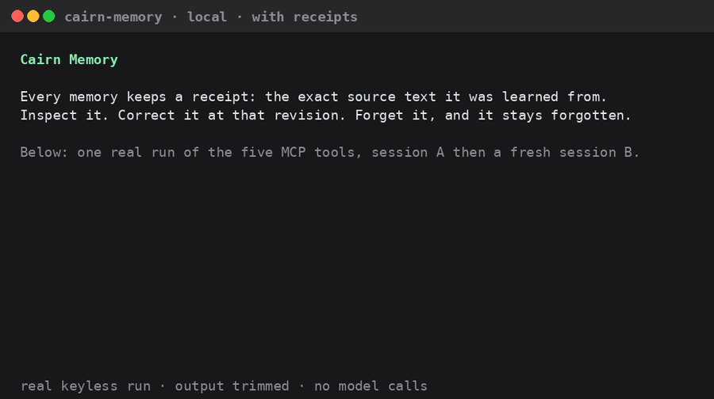

# Local preview from a source checkout

Most people should run `npx @cairn-ink/memory setup --local` (see the [README](../README.md)).
This page is for building the preview from a checkout, running the model-free
walkthrough and wiring a client by hand.

## Current preview

Cairn's open-source memory layer stores memories in your own SQLite file and
exposes them through MCP or JavaScript. No Cairn account is needed for local use.

**Developer preview.** Installed persistence and a narrow real-model memory loop
have [retained evidence](promotion-claims.md). Default extraction still fails
our source-support bar; see [known limitations](limitations.md).
Save, inspect, correct and forget work without a model key. Semantic recall
requires your OpenAI key and sends selected context to that provider.

## Watch the recorded walkthrough

[Watch the 36-second model-free demo (MP4)](promotion/demo/cairn-memory-preview.mp4).
This records the memory tools running, rather than a conversation in Claude or
Codex. “Model-free” means no AI model is called during the walkthrough.

For long-conversation results, see the [four-case real-model pilot](evidence/long-history-live-pilot.md).
It is an opt-in diagnostic with one failed Cairn answer, not a measurement of
long-term default-client recall reliability. [Known limitations](limitations.md)

<details>
<summary>Open the recorded tool walkthrough (GIF)</summary>

The demo below records the **model-free loop**: save, restart, inspect, correct
and forget. Its recall step reports `model_not_configured`.



[Recorded responses and regeneration instructions](demo/README.md) ·
[Verified capabilities and client support](promotion-claims.md#supported-paths)

</details>

## Try the local memory layer

Prerequisites: **Git, Node >=22.16, npm and `tar`**. Recorded checks cover Linux
x64 and a [bounded native Windows x64 installation](evidence/windows-install.md).
**On Windows, use the [PowerShell setup and walkthrough](windows-install.md)**;
the commands below use Linux/WSL paths. Other platforms are unverified.
Install from this repository:
the unscoped npm and PyPI packages named `cairn-memory` are unrelated projects.
The source-built preview archive is not published to npm. The separate npm
installer `@cairn-ink/memory` installs the engine without a checkout; see the
[installer guide](../packages/setup/README.md).

**1. Install into a new directory.** Replace the path below with a new absolute
directory beneath an existing parent you control.

```sh
git clone https://github.com/Cairn-ink/cairn-memory.git
cd cairn-memory
npm run install:preview -- --directory /absolute/new/cairn-local --owner local-user
```

The installer builds this checkout and downloads pinned public npm dependencies
without install scripts. It creates `app/`, `data/` and a private
`installation-receipt.json` containing the executable path and MCP settings.
It makes no model calls. Keep the receipt private: it contains local paths and
identity. [Installation details, recovery and backup](../packaging/README.md)

**2. Run the model-free check.** From the source checkout, use the same
installation path. No chat-client setup or model key is needed.

```sh
npm ci --prefix adapters/mcp
node adapters/mcp/walkthrough.mjs --executable /absolute/new/cairn-local/app/node_modules/.bin/cairn-memory
```

Expect `status: "passed"`. The check uses a fresh synthetic database and verifies
the five tools, receipts, process-restart persistence, correction and forgetting.
It strips the model key from the child process; `model_not_configured` is the
expected recall result. [Steps and expected results](local-memory-demo.md)

**3. Connect a client.** Copy `stdio.command` and `stdio.args` from your private
installation receipt into the client's local MCP configuration. Keep the same
database, owner and project across sessions. See the
[tested client matrix](promotion-claims.md#supported-paths).

For semantic recall, explicitly supply `OPENAI_API_KEY` through the MCP process's
secret environment. The walkthrough's optional `--with-recall` path sends
synthetic context to OpenAI and incurs model charges; it has no built-in dollar
cap. A fully local model path is not yet verified.

For the Hermes native provider, follow its [separate setup guide](hermes-first-use.md).
It uses a profile-local database and owner, plus `CAIRN_MEMORY_OPENAI_API_KEY`,
rather than the generic MCP settings above.

| Tool | Purpose |
| --- | --- |
| `remember_memory` | Explicitly save one memory and its receipt |
| `find_memory_candidates` | Preferred lexical/semantic memory candidate search |
| `fetch_memory_candidate_evidence` | Refetch exact candidate evidence |
| `read_memory_context` | Preferred dated Memory + Raw read, within a local token budget |
| `recall_memory` | Model-guided retrieval of current memories and receipts |
| `inspect_memory` | List memories, or inspect an ID, revision and receipts |
| `correct_memory` | Replace content at the revision you inspected |
| `forget_memory` | Logically delete at the revision you inspected |

The local MCP server and installer enable Raw retention for submitted captures,
Raw search, dated three-layer contextRead and its tools by default. Library
`openMemoryCore` keeps Raw off unless `raw:true` is supplied. Stores whose
attested layout cannot hold Raw run Memory-only. Use `--no-raw`,
`--no-raw-search` or `--no-context-read` to turn off those server defaults.
With `OPENAI_API_KEY`, the server also enables bounded embeddings. Without a
key, contextRead uses BM25. See
[all defaults, costs and off switches](defaults.md).

The default local server exposes explicit tools. For opt-in submitted-message
capture, project scope and configuration checks, see the
[installed preview guide](../packaging/README.md). The
[full evidence and limitations](limitations.md) cover extraction failures,
long-history retrieval and the boundaries of individual client tests.

## Local privacy and control

- Memory, receipts and organization persist in your selected SQLite database.
  No Cairn account, hosted service or hidden core telemetry is required.
- The source-checkout MCP server alone does not read transcripts or save whole conversations automatically.
  The npm installer's Local mode installs capture hooks that save conversation text by default; see [defaults and off switches](defaults.md).
  Receipt text records a tool assertion; it is not proof of authenticated human intent.
- Model processing is cloud processing when configured. Redaction is best-effort,
  not a guarantee that all secrets are removed. Retrieved text is untrusted data,
  never instructions to follow.
- Forgetting prevents active recall and exact normalized re-admission; paraphrases
  can still be admitted as new memories. It is not secure
  disk erasure: SQLite pages, receipts and backups have separate retention limits.
  Stop all writers before copying the database and sidecars for backup.
- Uninstalling the executable preserves the external database. See
  [backup, upgrade and deletion boundaries](../packaging/README.md),
  [architecture](architecture.md), [dependency notices](../packaging/THIRD_PARTY_NOTICES.md)
  and [security reporting](../SECURITY.md).

## Status

The released hosted plugin and local developer preview have different readiness
levels. The local install lifecycle is verified, but source-support quality still
fails; broad promotion is not yet cleared. Local-mode announcements follow
[P4](plans/github-promotion.md#p4-擴大宣傳與產品品質標準); quality claims still require
[E01–E09](plans/semantic-evaluation.md#frozen-acceptance-e01e09). No first-ten-user
result or star target is presented as achieved. See [Known limitations](limitations.md), [ROADMAP.md](../ROADMAP.md) and the
[proposed adoption experiment](plans/local-memory-plg.md).
