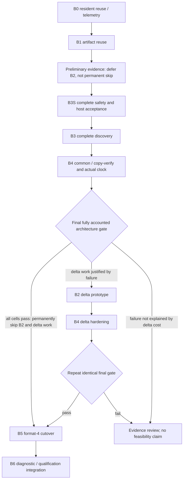

# Context-read incremental catch-up design (fix B)

Status: **sixth design revision, 2026-10-29; implementation not authorized**.
Rounds 1–5 were approved by two non-author reviewers. This revision adds the
hosted product's B3S interface requirements. The narrow owner-only lineage-recovery
inspection exception in §2.2 is **pending project-owner confirmation**; prior
review approvals and the confirmed lineage semantics (c) do not authorize it.
The as-of contract decision was recorded 2026-10-28.
The project owner selected **(A)**: target p95 staleness ≤30 s, hard bound
**X = 60 s**, partial fallback beyond X, with immediate removal/correction/access
checks independent of X. This is authorization for the design direction, not an
implementation, migration, registration, measurement or qualification pass.
Protocol revision 4 is being drafted separately by the qualification owner;
this document specifies the engine handoff and does not amend contract files.

## Evidence and contract boundary

All repository `file:line` citations below refer to the merged fix A + P2e
convergence base **`25abe2d4`**, inspected read-only. Earlier draft citations to
separate branches are superseded. The authoritative contract is
`docs/plans/context-read-product.md`, not the shorter host guide.
The historical round-3 re-reviews requested changes: soundness had one P1 and
two P2s; scope had four P2s. Their dispositions remain recorded in §11 without
private locations. Rounds 1–5 are now approved by two non-author reviewers;
those approvals do not cover this sixth revision or grant implementation approval.

The checked-in §6.1.2 and §10.4 still require strict currentness
(`docs/plans/context-read-product.md:421`, `:657`). They are historical constraints
for comparison, not an as-of implementation permission. Revision 4 must carry
the decided semantics, status/coverage shape, P2-21 expectations and new Q4
oracle before any release or qualification claim. No old result can be relabeled.
All estimates and branch thresholds here are planning choices, not measurements.

## Decision for product owners

**Decision made by the project owner on 2026-10-28: (A).** The hosted product
owner recommended (A); its requirements below are mandatory inputs. The short
comparison records the basis of the decision rather than reopening it.

| Question | (S) strict currentness — not selected | (A) bounded as-of — selected |
| --- | --- | --- |
| Q4 reachability | Revision-3 planning schedules need mean repair lag about **35 ms on v18, 20 ms on mixed schemas** for 1% stale time; overlap locally allows about 16.7 ms. At 100 ms, whole-session stale time is already 2.79–2.87% / 4.86–4.96%. There is no measured basis to expect the required lag, especially for organizer fan-out and DELETE contention. These time fractions are not scheduled-A qualification. | New target: **p95 staleness ≤30 s; ≤1% of scheduled requests beyond 60 s or not ready**. Reads can use an intact certified E while catch-up runs. This buys a seconds-scale repair budget, not permission to stop advancing E. Feasibility still requires measurement. |
| Minimum engine work and honest size | B0–B3, the lexical reconciliation/audit portion of B4, B5 and B6 with the strict oracle; omit A-only clock witnesses/bounded status. Roughly **6,000–12,000 changed lines**, plus strict-current dispatch/admission and measurement work (**+800–1,800**). Selective watches may be needed (**+900–1,800**). Even this has no Q4 guarantee. | Use **B0 → B1 → B3S complete safety → B3 → B4 common/copy-verify → final architecture gate → B2/B4 delta work if needed → B5 → B6**. Preliminary B1 evidence may defer B2; only the fully accounted gate may permanently skip it. **7,200–13,700 changed lines** with deltas, **5,950–11,350** with copy/verify, including meaningful tests/docs; separate qualification harness prerequisite **1,000–2,200**. Optional tail, vectors, Merkle trees and general watches are excluded. |
| Contract changes | §6.1.2 exact-current final comparison and §10.4 exact-new-ref/strict-not-ready gates stay. P2-21 E publication is certified but refused after E+1. Fallback still counts not ready. | Revision 4 must permit E after newer canonical writes, define proven staleness and final safety checks (§2), replace the §10.4 Q4 freshness/availability predicate, and change P2-21 reader/service expectations. It must also permit installing an already closed E when the final check sees E+1. E is never relabeled. Beyond-bound fallback remains a failed engine freshness/availability attempt. |
| User-visible effects | Frequent index-unavailable responses during ordinary writes; new content waits for exact-current publication. | New items may be absent until coverage advances, for at most the 60-s accepted bound; aim for p95 ≤30 s. Confirmation/pinning and ranking may lag. Removals, corrected old text and inaccessible content have **zero** allowance. Freshness metadata identifies E and its proven age. |

**Engine's recommendation:** measure resident/artifact reuse first, with complete
canonical discovery, conservative Card reevaluation and mandatory final safety
checks; retain copy/verify if the fully accounted path passes, otherwise prototype
the flat-table lexical delta slice. Measure before buying a tree engine or a general
watch graph. This recommendation supports the owner's recorded decision; it is
not itself the decision or a claim that Q4 is met.

### Immediate removals and corrections: what is already safe, what must change

An as-of read **must not return a Memory forgotten, hard-deleted, privacy-purged,
superseded or made access-ineligible after E**, nor an excerpt containing that
content. An item corrected after E must have canonical's current text or be
omitted. Use omission on exact-revision mismatch in the first implementation.
The next read begun after forget commits must exclude the content on every
surface, including history, candidates, assembly, exact evidence, cached pages,
the optional tail and the hosted product's fallback. X never applies here.

| Case after E | Existing canonical evidence behavior at the convergence base | Required (A) disposition |
| --- | --- | --- |
| Memory forget | Ordinary forget leaves a revised tombstone, nulls content and removes receipts (`core/runtime.mjs:305`). `memoryRow` selects `deleted=0`; exact evidence then checks eligibility/revision (`core/private-evidence-storage.mjs:41`, `:73`). Assembly skips unavailable/conflicting refs, then refetches delivered items (`core/context-product-index.mjs:114`, `:139`). | Existing final exact fetch drops it. Retain this check even when E is accepted; never assemble text/excerpts from snapshot rows. Apply it to every returned candidate/page, not only assembled text. |
| Hard delete | No canonical row means evidence unavailable under the same lookup, even if no epoch advanced. Independent hard deletion is a real test mutation (`core/test/context-read-assembly-races.test.mjs:42`). | Final lookup drops it immediately. Every catch-up completely enumerates canonical metadata and diffs identities to remove stale index membership and certify completeness (§3); discovery latency is separate from immediate safety. |
| Correction | Canonical correction changes text, increments revision and replaces receipts (`core/runtime.mjs:275`). Evidence rejects a snapshot ref's old revision (`core/private-evidence-storage.mjs:75`; Cards `:62`). | Omit mismatched refs, including all old excerpts and cached candidate metadata. Do not silently keep an old score/ref while substituting new text. Current-text reranking is separate work. |
| Card deleted or ineligible | Detail refuses cancelled/deleted Cards (`core/private-card-storage.mjs:127`). Current-intent evidence reevaluates support/applicability/dependencies (`core/private-evidence-storage.mjs:54`, `:59`); support resolves live bindings (`core/private-card-storage.mjs:109`), method state is compared live (`core/card-current-storage.mjs:34`). | Require full confirmed/current retrieval eligibility for both intents; today history bypasses it. Authenticated draft inspection uses §2.2's draft policy, with the same suppression and lineage requirements. Add durable body lineage (§2.3) so lost bindings cannot hide erased contributors. Keep stricter live confirmation checks initially. |
| Supersession or privacy loss in history | History deliberately admits undeleted historical Memories and confirmed Cards with lost support (`core/private-evidence-storage.mjs:54`, `:56`; `core/context-read-sidecar.mjs:671`). Supersession has an ordinary history surface (`core/runtime.mjs:497`). Thus current evidence checks alone are **not** the required any-surface exclusion. | Add a common live safety predicate for supersession, privacy tombstones and source lineage, independent of intent. History may retain other allowed history, but cannot bypass this exclusion. Withdraw/revise the historical-content contract in revision 4 where it conflicts. |
| Owner purge/privacy deletion or access revocation | The semantic gate checks vector policy/purge epoch (`core/context-semantic-gate.mjs:9`); lexical finalization checks request access (`core/context-product-index.mjs:67`) but does not consult an owner content-purge tombstone. Vector purge is **not** canonical content deletion. Raw deletion has a canonical cascade (`core/raw-deletion-storage.mjs:117`), but that is not proof of complete owner-wide suppression. | Add a durable canonical owner/item/source suppression check shared by lexical, exact, history and fallback paths. A privacy delete must commit suppression before acknowledging success, then clean content/derived artifacts. Pending/failed purge remains suppressed. Product checks collection ACL at request time and supplies current authority; engine retains both request checks and final namespace/item authorization. |

This requires an engine-wide safety seam, not only relaxing
`storage.observe`. If suppression cannot be established or the final canonical
check times out, refuse that item/result; never use stale cached evidence.
Source excerpts must be fetched and checked from current canonical receipts and
source lineage, including suppression of a forgotten source in a derived Card.
Existing assembly reads live receipts (`core/context-product-index.mjs:116`),
but same-revision receipt loss and history's permissive support need explicit
safety tests. Do not claim the existing code already proves all these cells.
The hosted product must route its own surfaces/fallback through equivalent
checks; engine-only work cannot certify private application caches.

### New content and advancing generations

No fallback is required solely because new items are absent inside X. A known
new ref can still be fetched directly from canonical after the same safety
checks. Beyond X, unknown age, corruption or no certified generation, use the
existing partial fallback; its success never upgrades the engine attempt.
The optional session-start tail in §2.6 may reduce missing recent next steps,
but is not required for base (A) readiness.

Publish what was certified and retain useful work across retargets (§5).
The old report-only catch-up at 1,642 Memories/26 Cards ends about **40 s** after
the last burst; that already exceeds the **30-s target**, even though it is
below the newly selected **60-s hard bound**. These two limits must not be
conflated. The largest F/A base, 3,336/333, has much more corpus work (§1), with
no measured repair-time promise. Under continuous writes repeated abandonment
can also exceed 60 s. (A) still needs measured resident/artifact reuse, complete
discovery and publishable closed frontiers. Finite lexical deltas and incremental
verification/statistics remain conditional on the largest-corpus reuse result.
Retarget reuse alone leaves corpus copying/verification intact.

## 1. Measured problem and smallest useful change

Fix A handles fence races, accounting and cadence, but leaves whole-projection
scans/copies and verification
(`docs/plans/context-read-maintenance-convergence.md:113`, `:305`, `:359`).
The current sidecar restarts a nonmatching target, copies unchanged contributions
and verifies complete generations (`core/context-product-sidecar.mjs:586`,
`:608`, `:624`, `:351`, `:368`). Resident handles also drain/reopen when the pump
alternates intents (`core/context-product-pump.mjs:173`, `:179`).

The report-only diagnostic seeded **1,642 Memories/26 Cards**, wrote **21**
Memories in `[1,2,3,4,5,1,2,3]` bursts every **12 s**, and measured p95
**111,802.827 ms**, maximum **123,786.795 ms**, zero unresolved. All commits were
first found after the final burst; the last three took roughly 39.7–39.8 s.
Errors/unavailable observations remain in that report; it is not qualification
(`docs/plans/context-read-maintenance-convergence.md:766`, `:781`, `:815`, `:833`).

Retain the first draft's source-derived work model, not a new timing result:

| One eligible insertion, per intent | Diagnostic 1,642/26 | Largest F/A base 3,336/333 |
| --- | ---: | ---: |
| Minimum canonical rows scanned | 1,669 | 3,670 |
| Unchanged documents copied | 1,668 | 3,669 |
| Unchanged postings copied | 19,886 | Depends on frozen qualification text |
| New document/postings | 1 / 9 | 1 / 9 |
| Lexical manifest hash-input bytes | 2,477,798 | Recompute from frozen qualification fixture |
| Verification row visits | 46,448 | Recompute from frozen qualification fixture |
| Minimum metadata pages / verification pages | 58 / 352 | Layout/recipe dependent; measure in B1 |

The model enumerates frozen T1 document terms, exact document/posting/statistic
tuples, and `2D + 2P + 2(T+1)` verification visits. Pages use 128-row limits and
terminal Card streams; hash bytes are not SQLite I/O. Source anchors:
`core/context-read-tokenize.mjs:15`, `core/context-product-sidecar.mjs:334`,
`:370`, `:404`, `:423`, `:443`, `:449`, `:454`, `:610`, `:643`;
`tools/testing/context-product-freshness.diagnostic.mjs:26`, `:56`;
`tools/testing/fixtures/context-product/v4-definition.json:7` fixes world sizes.
The earlier draft's exact largest-corpus posting/hash/page estimates depended on
a separate qualification recipe not present in this pinned base. Do not transfer
those counts as merged-base evidence: B1/QH must regenerate them from the frozen
fixture. Actual quanta, phase timings and I/O were not measured in that calculation.
`maxItems=32` limits transformations, not these page visits. A 60-Memory
organizer commit needs at least two transformation calls per affected intent
before byte/time limits and Card fan-out.

The default-Q4 path is lexical. Existing vector materialization and verification
also scan/copy memberships (`core/context-product-vectors.mjs:63`, `:199`, `:225`),
but vector reuse, semantic budgets and paid-cache redesign are **separate work**.
Do not put them ahead of the lexical feasibility checkpoint.

## 2. Selected (A) reader contract and safety rules

### 2.1 Readiness and proven staleness

A generation E certifies a complete projection at one coherent canonical snapshot,
including selection/types/intent, complete identity/revision/eligibility map,
Raw/namespace/method fences, lineage fingerprints, representation, counts and
logical manifest. Scalar epochs are hints, **not completeness proofs or seconds**.
Do not use item `updated_at`, sidecar mtime, build start or publication time as
claimed staleness evidence.

Use a **coverage witness** binding E to that snapshot:

1. Sample the elapsed clock immediately before acquisition of the canonical
   snapshot that proves complete comparison/closure (§3.2/§5). Bind `tE`, clock
   domain/incarnation, canonical/store identity, selection, comparison digest,
   fences and E in the authenticated witness. Lock acquisition consumes budget.
2. **Only a successful complete comparison can renew a witness.** Enumerate all
   selected canonical metadata, unconditionally reevaluate all Cards (including
   previously ineligible ones), and compare identities, revisions, eligibility,
   provenance and fences with E. Do it in one coherent snapshot. If equal, the
   maintainer may record its pre-acquisition clock sample as the new witness for
   the unchanged E. Unchanged scalar epochs/fences alone never establish equality,
   never set age to zero and never renew a witness: an independent delete can
   leave them unchanged. Publication itself earns no freshness credit.
3. Ordinary open/status/read requests check the authenticated witness, certificate,
   selection/access, store identity and live revocation/safety state, without a
   corpus scan or request-side renewal. Compute **`ageUpper = now - tE`**, including
   final delivery work, from the latest successful complete comparison for E.
   Every omitted selected commit is later than that comparison's snapshot, so
   this is an upper bound on its age, not an exact commit timestamp. Even after
   an equal comparison, report elapsed age rather than zero at a later read.
4. Accept bounded-as-of readiness only when `ageUpper ≤ 60,000 ms`, certificate
   and witness are valid, no audit/purge/identity/access failure exists, and all
   outgoing items pass §2.2. Recheck at final delivery and cursor resume,
   including crossing 60 s during assembly. Counts describe E, never current
   canonical counts. E can be ready-as-of while E+1 is catching up.

**Selected clock backend for B4:** on Linux, a small native binding to
`clock_gettime(CLOCK_BOOTTIME)` returning integer nanoseconds. CLOCK_BOOTTIME
[includes system suspend](https://www.man7.org/linux/man-pages/man2/clock_gettime.2.html); `Date.now()`, `performance.now()` and Node `hrtime`
are not substitutes for this contract. Bind the value to the kernel boot identity,
authenticated supervisor incarnation and clock/time-namespace identity shared by
all supervised Workers/readers. Linux [time namespaces](https://www.man7.org/linux/man-pages/man7/time_namespaces.7.html)
virtualize that clock; verify that every participant shares the same domain;
container/time-namespace mismatch refuses bounded-as-of readiness. The binding
must be packaged and demonstrated in B4; it is not present in the current code.
Unsupported platforms, unavailable boot/domain attestation, read failure,
regressing samples or any uncertainty invalidate time witnesses and fall back.
There is no wall-clock or uptime-text fallback. A platform without this backend
needs a separately demonstrated suspend-safe provider before enabling (A).

Supervisor/domain restart invalidates prior witnesses even on the same boot.
A new successful complete comparison against E can establish a new witness;
a lagged E cannot be redated at reopen. It needs a newly closed generation.
B4 must demonstrate suspend/resume with a canonical write, reboot/restart,
Worker-domain mismatch, clock failure and expiry before accepting fully accounted
architecture results. Platform enablement must be explicit in registration.

This conservative bound can overstate age after long idle gaps. Periodic complete
comparisons may renew it while E really matches; their corpus/support/lock cost
is charged to maintenance, never hidden in a cheap scalar equality observation.
Qualification independently compares coverage with native commit traces. Revision
4 must freeze this upper-bound definition and the public linearization point:
proposed acquisition of the fresh final safety snapshot, conditional on validation
and delivery completing inside the bound and cutoff. No request performs index
maintenance or deep verification.

### 2.2 Final per-item checks, every surface

Keep `final`'s request-authority checks and canonical transaction, pointer binding
and item revalidation (`core/context-product-index.mjs:67`, `:137`, `:190`, `:202`).
Replace the **whole-projection exact-current equality requirement** with
§2.1's bound, both in `storage.observe` and assembly's final namespace-fence
equality (`core/context-product-index.mjs:138`). Retain exact per-item fence
equality (`:143`); unrelated writes must no longer force a safe assembly stale.
Do not remove exact per-item checks or the fresh transaction after any await.
Snapshot/cursor tokens bind publication, access, policy and witness identity; a later observation may tighten age but cannot upgrade old rows to a
new epoch. Pointer change may conservatively refuse a cursor rather than mix
publications. Keep the unchanged final pointer identity rule initially.

For each outgoing ref, text, title, snippet, source excerpt and metadata object:

* Check live owner/namespace/caller access and durable owner/item/source privacy
  suppression, existence, deletion and supersession. Suppressed or unresolved
  lineage means omit/refuse, even for history and empty-query/cached surfaces,
  except for the pending, owner-only recovery inspection defined below. Known
  suppressed content never qualifies for that exception.
* Refetch canonical evidence, evaluate purpose-aware Card eligibility and compare
  exact revision/body revision and source identities. If corrected, omit it.
  Do not expose snapshot title/body/excerpt or cached metadata from that item.
  **Confirmed state and current Card support, applicability and dependency
  eligibility are mandatory for retrieval under both `current` and `history`.**
  The history shortcut at
  `core/private-evidence-storage.mjs:54` and the early return at
  `core/context-read-sidecar.mjs:671` must not bypass it; privacy-only filtering
  is insufficient. History may retain other permitted historical Memory states
  only after intent-independent supersession/privacy checks.
* Revalidate live receipts and sources for excerpts; if bytes/provenance changed
  between preparation and completion, omit or refuse atomically, never deliver
  a partly stale assembly. A bounded retry may refill from the certified ranking;
  its horizon is finite and does not promise a new full current top-24.

Canonical checks are bounded by candidate/assembly limits and dependency budgets.
Failure to finish is an honest refusal, not permission to skip safety. Requests
begun after a committed forget see the tombstone in a fresh snapshot. Concurrent
in-flight reads retain the final-snapshot linearization rule; owner-wide privacy
operations must stop new admissions and drain/cancel admitted reads before
acknowledging erasure if a stronger after-ack guarantee is promised. Existing
§4.1 authority limits are not silently upgraded to global cross-process leases.
The hosted product owns its request-time collection ACL check and stopped-client
cache erasure; engine controls must fail closed on changed authority.

**Purpose-aware eligibility.** All owner reads require access + restore admission
(§3.4) + owner/item/source suppression + existence/deletion/supersession + exact
identities. Proven complete body lineage is additionally mandatory except for
the narrowly defined fourth purpose below. Retrieval (`current` or `history`)
additionally requires confirmed state and full current support/applicability/dependency
eligibility. Authenticated draft inspection uses a separate draft-state policy:
verified owner authoring authority, extant `draft` state, exact draft revision/body
identity, complete lineage and live unsuppressed contributors. It does not require
confirmation or confirmation-time applicability/dependency declarations. Purpose
is selected by the trusted method/authority mapping, never a caller flag that
turns retrieval into inspection. A forgotten-source draft stays hidden, including
its title, body and excerpts. This keeps `getCard` usable in the confirmation flow
(`adapters/mcp/review-card.mjs:127`); the retrieval helper rejects drafts at
`core/context-read-sidecar.mjs:668`. Confirmation itself repeats the draft safety
checks before its atomic transition (§2.3). Ordinary confirmed detail uses the
retrieval policy; authoring inspection does not admit suppressed confirmed content.

**Confirmed-Card review.** A confirmed Card can lose current dependency or
applicability eligibility without any safety problem, for example after a
method-binding change gives it a `needs-review` dependency status while it stays
`confirmed`. The existing repair workflow first
inspects the Card (`adapters/mcp/review-card.mjs:127`) and then revalidates its
dependencies (`adapters/mcp/review-card.mjs:170`). Requiring current eligibility
for that inspection would make repair impossible. A third purpose, authenticated
confirmed-Card review, therefore requires:

* verified owner authoring authority;
* `confirmed` state, including a `needs-review` dependency status;
* exact revision and body identity;
* complete lineage and live, unsuppressed contributors;
* the common predicate.

It does not require current dependency or applicability eligibility, and its
result is never a retrieval result. Suppression still hides the Card from review.

**Fourth purpose: authenticated lineage-recovery inspection — pending
project-owner confirmation.** This is a **narrow, owner-only exception to the
zero-tolerance read rule**, for legacy bodies whose lineage cannot be proven.
The project owner must explicitly confirm this exception before it is enabled;
until then, unknown-lineage title/body reads remain denied. It requires verified
owner authoring authority, an extant draft or confirmed Card, exact current body/
revision identity, and `unknown` lineage with **no known suppressed contributor**
under §2.3's full recoverable-evidence check. All other common safety checks still
apply. It returns the title and body so the owner can choose keep-as-own, rewrite,
regenerate or delete; inspection itself neither changes provenance nor makes the
body retrievable. A recovery that retains a body must create the complete new
revision in §2.3; deletion requires no new readable body.

**Residual risk the project owner is asked to accept.** "No known suppressed
contributor" cannot prove absence. If a Card's text was derived from a
contributor that was later forgotten, and every recoverable association between
that Card and the forgotten contributor has disappeared, the evidence check finds
no match and recovery inspection can show the owner text derived from content
they forgot. This is the only exposure the exception permits. It is distinct
from evidence that is unavailable, unexamined, ambiguous or over budget, which
continues to refuse.

This purpose is selected only by a dedicated trusted owner-authoring method and
authority mapping, never a caller `purpose`, `inspect` or other flag. AI callers,
assembly, candidates, fallback, tail, search/recall and ordinary retrieval/detail
cannot reach it, inherit its credentials or consume its result. It is not an
alternative policy for complete-lineage Cards. Recheck authority, exact body and
all recoverable suppression evidence at final delivery; missing checks, unavailable
required evidence or exhausted validation budgets deny inspection.

**Known-forgotten bodies remain hidden, title included.** Any known suppressed
contributor, even in an `unknown` body, denies title, body, snippets and excerpts
on every purpose. A separate authenticated owner recovery-metadata response may
expose only created time, collection/namespace and surviving-source count, plus
the actions **regenerate from remaining sources** and **delete**. No source names,
source text, title-derived labels or keep-as-own/rewrite inspection is exposed.
The count is of known surviving sources validated live, not a claim of complete
lineage. This metadata exception does not bypass owner/item suppression, access,
deletion or restore admission; an owner-wide erasure still denies everything.
It is never a retrieval result. Action targeting uses an authority-bound opaque
handle without content, not a discoverable content identifier or title.

Every entry point must invoke this common predicate plus its purpose policy,
including paths outside the product index's `final`:

| Surface / entry point in the convergence base | Required integration |
| --- | --- |
| Initial candidates/cached first page — `core/context-product-index.mjs:202` | Validate all outgoing refs and metadata in the final canonical snapshot. |
| Cached cursor resume — `core/context-product-index.mjs:190` | Recheck safety, current eligibility, witness expiry and revocation; cached rankings confer no exception. |
| Assembly preparation — `core/context-product-index.mjs:114`, `core/context-product-index.mjs:116` | Check canonical items and receipt excerpts before preparing any bytes. |
| Assembly final refetch — `core/context-product-index.mjs:137`, `core/context-product-index.mjs:139`, `core/context-product-index.mjs:143` | Repeat the predicate, retain exact item/source fences and refuse a partly stale assembly. |
| Exact evidence via facade — `core/context-read-facade.mjs:703`, final refetch `core/context-read-facade.mjs:714` | Bare exact refs resolve authoritative current-body lineage without relying on any old index/source set. |
| Private evidence select/fetch/revalidate — `core/private-evidence-storage.mjs:179`, `core/private-evidence-storage.mjs:180`, `core/private-evidence-storage.mjs:103` | Shared `itemsInside` at `core/private-evidence-storage.mjs:176` and selection eligibility both enforce it for both intents. |
| Source/receipt resolution — `core/private-card-storage.mjs:43`, `core/private-card-storage.mjs:251`, `core/card-receipt-sources.mjs:19` | Suppression before source dereference; verify source identities again at delivery, including Raw's asynchronous finish at `core/private-card-facade.mjs:58`. |
| Legacy Memory `fetch` — `core/runtime.mjs:492`, historical lookup `core/runtime.mjs:497`, ordinary completion `core/fetch.mjs:54` | Enforce suppression and exact item/receipt identity on current and historical bodies, receipt pages and cursor resume. After the final token-counter callback, refetch/revalidate all outgoing fields in a fresh canonical snapshot; the epoch assertion at `core/fetch.mjs:54`–`:55` cannot substitute for final suppression/item validation, including mutations without an epoch bump. |
| Complete source snapshots — `core/runtime.mjs:514` | Apply admission/suppression and item/source validation to the complete enumerated source set and final delivery. Never serialize suppressed bodies or excerpts; if filtering invalidates a promised complete snapshot, refuse or explicitly use a contract-approved filtered population, never silently claim completeness. Repeat validation after caller callbacks. |
| Card detail/list/organization callbacks — `core/private-card-storage.mjs:228`, `core/private-card-storage.mjs:273`, `core/private-card-storage.mjs:295` | Apply the trusted purpose policy: safe draft inspection and confirmed-Card review use their respective authoring policies; retrieval, ordinary confirmed detail, evidence and organization consumers require confirmed/current eligibility. Only dedicated owner recovery methods may use the pending fourth purpose or the restricted recovery-metadata response above. Ordinary lists/callbacks cannot inherit either exception; suppressed titles/bodies never escape. |
| Role evidence — `core/role-context-evidence.mjs:22` | Both current/history consumers inherit the shared predicate, including receipt excerpts. |
| Optional tail (not implemented) — reuse exact-fetch seam `core/context-read-facade.mjs:703` | Every tail ref passes the same predicate; no unvalidated session bytes. |
| Fallback — canonical selection/refetch `core/context-read-facade.mjs:603`, `core/context-read-facade.mjs:665`; private evidence `core/private-evidence-storage.mjs:179`; recall `core/runtime.mjs:546` | Engine seams enforce safety. The hosted product's Card search, recall, fallback and caches must demonstrate equivalent final checks; their implementations are outside this checkout. B3S host acceptance is a prerequisite to widening beyond the owner canary; B5 rechecks it for the new sidecar format. |

Confirmation/pinning may lag within X; keeping a stricter live check is allowed.
Coverage reports E's search/ranking completeness separately from safety omissions.
Omitting a corrected/deleted item is allowed; it must not imply that the remaining
list is canonical's current complete ranking. A required safety check that fails
for the whole response is not-ready; routine safe omission is disclosed separately.

### 2.3 Durable body lineage and privacy suppression (separate safety capability)

**Product semantics (c), confirmed by the project owner on 2026-10-29.** Each body
revision has a monotone source set. If any source in the current body revision's
set is forgotten, purged or privacy-erased, the Card disappears from every read
path until a new body revision exists (rewrite, regeneration, or an explicit
"keep as my own writing" revision). The product still reviews the DDL and the
legacy-seeding policy below. Shared collection Cards are product-side: the
product notifies the owner with a one-click unpublish and does not unpublish
automatically. Engine suppression covers the owner's read paths, including AI
reads, immediately.

The concrete gap is surviving bindings, not discovery: eligibility enumerates only
remaining bindings (`core/context-read-sidecar.mjs:678`), detail returns those with
the stored body (`core/private-card-storage.mjs:127`), and ordinary editing can
replace bindings without changing `body_revision` (`core/private-card-storage.mjs:214`).
A later rebuild or bare exact fetch (`core/context-read-facade.mjs:703`) can then
serve text derived from a forgotten source. Neither a journal nor a sidecar-only
source digest fixes that loss of history.

**Authoritative canonical records; proposed DDL shape for product review:**

| Proposed table / key | Required stored fields and invariants |
| --- | --- |
| `card_body_provenance` keyed by `(owner, namespace, cardIncarnation, bodyRevision)` | Exact title/body digest, provenance revision/digest, state `complete` or `unknown`, and origin (`derived` or explicit `user-authored`). Missing/mismatched headers deny; `unknown` denies title/body visibility except for §2.2's pending fourth purpose. Every readable body, including a body-bearing draft, needs an allocated revision/provenance identity. |
| `card_body_sources` keyed by the body key plus `(sourceNamespace, sourceKind, sourceKey, sourceIncarnation, sourceVersion)` | Append-only complete contributor set, with ancestor erasure identities and exact source-content identities. Receipt contributors include their parent Memory incarnation; Raw contributors include relevant conversation/message/span ancestry. Derived-Card inputs, if supported, flatten their complete transitive sets; unresolved/cyclic ancestry fails closed. No source text is stored. Index source erasure identities for suppression/cleanup. |
| `content_suppressions` keyed by `(owner, scope, sourceKind, stableKey, incarnation)` | Monotone privacy epoch, reason and cleanup status; owner-wide rows checked before item lookup. Pending, failed and complete cleanup states all deny. Source tombstones survive source/child-row deletion and sidecar rebuild; completed cleanup never lifts suppression. |

`content_suppressions.reason` distinguishes at least `user_forget`,
`correction_supersession`, `purge`, `privacy_erase` and `account_erasure`.
Preserve the reason in external-ledger append/replay and suppression pull results;
cleanup status is separate and never changes a denial into permission. Multiple
applicable reasons retain their denial facts rather than overwriting history.
Correction/supersession denials identify the retired source version where needed,
so they exclude old derived bytes without denying a valid new corrected version.

Source keys/incarnations are canonical durable identities. Reserve identities
referenced by provenance or tombstones against reuse; legacy keys receive a
migration identity, and recreation needs a new attested incarnation. Writer guards
reject reuse of reserved bare keys; old unversioned refs must never resolve to
a newly allocated incarnation. These rows have **no cascading foreign key to
bindings, receipts, notes or Raw child rows**.
Source cleanup may erase source bytes, never erase the surviving body's evidence
of contribution. Header/source consistency and append-only enforcement need
constraints and narrowly scoped safety guards, not a mutation feed. Validate the
complete set within an explicit budget; never truncate edges to fit. Over-budget
lineage denies the body until complete validation or a new safe revision is
possible. The provenance digest binds the sorted source set, body digest and provenance revision; compare it
at final delivery as well as closure. Missing referenced source identities are
unsafe even when an independent DELETE did not create a suppression record.

**Write invariant.** Creation or body replacement commits the exact body, allocated
`body_revision`, complete contributor set and header atomically. Confirmation
atomically preserves the accumulated draft provenance as specified below. For a
revision that survives a binding-only edit, union any newly declared contributors
into its source set and **never remove an existing contributor**. Removing a
binding or child row does not require a body rewrite and cannot shrink that set.
A source addition advances the provenance revision/digest even if body revision
is unchanged. Readers and closing scans observe it as a safety/provenance change.
Direct body SQL without matching provenance leaves a digest/revision mismatch
and fails closed; unsupported old writers must not silently bypass this invariant.
Do not reconstruct lineage from today's bindings on read or sidecar rebuild.

**Draft → confirmed provenance transition.** Draft creation currently stores a
null body revision (`core/private-card-storage.mjs:170`); B3S instead allocates a
durable draft body/provenance identity at creation. Draft binding-only edits union
contributors just like confirmed edits. On confirmation, preserve that exact body
identity and its accumulated complete contributor set, including contributors
whose bindings have disappeared; change state/revision and attach confirmation
metadata atomically. If the external confirmed-body numbering must differ, create
an immutable mapping and copy the **entire accumulated set**, never renumber by
resetting lineage. The existing unconditional assignment to revision 1 at
`core/private-card-storage.mjs:208` must be replaced. The binding replacement and
byte-based revision seam at `core/private-card-storage.mjs:214` must handle draft
edits, source additions and identical-byte authorized recovery consistently. A
forgotten contributor blocks title/body inspection and confirmation. Unknown
lineage blocks draft inspection, confirmed review and confirmation; only the
pending fourth purpose may inspect it under §2.2. Confirmation is never an
implicit recovery action. A new actual body revision
must establish complete provenance; binding edits cannot erase prior edges.

**Visibility.** Before returning a Card on any owner surface, load the header
for its **current body revision** and check every contributor/ancestor against
current existence/deletion and suppression state. Compare exact source version/
content identities as well: a corrected former contributor cannot leave old
derived text visible through a removed binding. If any has been forgotten,
purged or privacy-deleted, suppress the **entire Card**, not just its citations,
on current, history, exact fetch, Card search/recall, assembly, tail and fallback.
This is zero tolerance independent of X, even when other surviving bindings
remain valid. Historical exact refs cannot resurrect an old body. Incomplete
bounded validation always refuses. Unknown lineage refuses title/body reads
except for §2.2's pending owner recovery-inspection purpose; known-forgotten
bodies permit only its restricted content-free recovery metadata/actions. An empty
surviving binding list is not proof of user authorship. Apply §2.2's purpose policy
in addition: confirmed/current eligibility for retrieval and ordinary confirmed
detail, draft-state eligibility
for authenticated draft inspection, and the review policy for authenticated
confirmed-Card review. Those three purposes still require complete lineage.

**Recoverable evidence for the fourth purpose.** “No known suppressed contributor”
means no match across the union of **all recoverable canonical evidence** tied
to this Card incarnation and body revision, not just surviving bindings. Examine
current bindings and receipts (including parent Memory and Raw ancestry), retained
body/source/provenance records, authenticated operation-ledger payload bindings
(`core/private-operation-helpers.mjs:18`), recovered external-ledger seeds (§3.4),
and any other canonical trace, including recoverable historical associations and
trustworthy retained backup evidence. A backup inadmissible for serving under
§3.4 may still supply a verified positive contributor link; examining it never
admits that backup for reads. Any trace that establishes a
contributor or ancestor identity is positive evidence even when it cannot prove
the complete source set. Conservatively union plausible associations when their
revision mapping cannot exclude the current body; do not discard a known link
merely because its binding/receipt was deleted.

Payload bindings are commitments, not recoverable source lists: the Card payload
binding is keyed (`core/private-card-storage.mjs:302`,
`core/private-card-input.mjs:92`). Examine retained candidate operation payloads
and source associations where their binding can be verified; do not claim to
invert a digest, infer absence from an opaque binding, or treat the stored result
alone as complete history. Recovered ledger seeds supply denial identities;
cross-match them with every recovered contributor/ancestor association, including
owner-wide and namespace-wide scopes. A match in **any** evidence source denies
inspection, title included, regardless of other live bindings or an `unknown`
header. Unknown completeness alone is the proposed exception; unavailable or
unexamined recoverable evidence, uncertain identity mapping and incomplete bounded
validation are not evidence of no match and must refuse. Persist the recovered
known edges/evidence origin during migration so reads do not ignore a lost trace;
new evidence and suppressions invalidate prior inspection authorization.

**Recovery.** Only a **new body revision** with a complete source set excluding
the removed item can reappear: a user rewrite, system regeneration from remaining
sources, or an explicit user “keep as my own writing” action recorded as a new
revision with source `user-authored` (an explicit source-set marker keyed to the
authorized action, not an empty implicit set). Recovery must allocate a new
`body_revision` even if the chosen title/body bytes are identical; ordinary
byte-change-based revision logic is insufficient. The keep-as-own action must be
an explicit authorized provenance reset, never inferred from removing a binding or copying stored text.
The content-free `user-authored` marker records the **authorizing actor**, trusted
**authorization time** and **host action id**, bound to owner, Card incarnation,
new body revision and digest. It stores no title, body, excerpts or source text.
Retries with the same owner/host action id and identical authorization/body binding
return the same revision/marker; conflicting reuse refuses. Persist the marker
atomically with that revision and preserve it through backup/restore for audit.
For this explicit user-authored mode, support is eligible only when its canonical
authorization marker matches the current body digest and no external contributor
is declared; validate that marker rather than dereferencing a nonexistent source.
Retrieval still requires confirmation and current applicability/dependencies;
draft inspection retains its draft-state policy. Owner/item suppression and access
checks always apply. Mixed user/source bodies retain all external contributor checks. Prior revision sets/tombstones remain
immutable; old references stay unavailable. A normal regeneration must not
silently relabel retained source-derived bytes as user-authored.

**Legacy seeding / migration, flagged for product DDL and policy review.** Under
quiescence, capture every extant body digest and union its current bindings with
recoverable historical evidence for that same body revision (retained source
records, authenticated operation/provenance history and trustworthy backups if
available). Record evidence origin and completeness. Current bindings alone are
a **lower bound**, never proof that no binding disappeared. Mark `complete` only
when evidence proves the entire contributor set, or proves original user authorship.
Otherwise seed known edges but set `unknown` and suppress that body on every
retrieval, legacy/fallback and ordinary authoring route until a new complete
revision is created. Only §2.2's pending owner-only fourth purpose may expose its
title/body after the full recoverable-evidence check; known suppressed contributors
always restrict it to the permitted recovery metadata/actions. The project owner
must confirm that narrow exception separately from legacy-seeding/DDL review.
Do not grandfather unverifiable bodies or silently classify them as user-authored.
A new rewrite/regeneration does not require historical certainty about the old
body, but must establish complete provenance for the new one. The product owner
must review the proposed tables, recoverable-evidence criterion and resulting
legacy suppression before rollout. No migration runs as part of this design
revision.

**Purge ordering and durability.** The host must durably append the erasure to
§3.4's external ledger **before forget, purge or erasure is acknowledged**, or in
the same durable step as that acknowledgement. Canonical owner/item/source
suppression commits with forget/privacy deletion, or before acknowledging a
multi-step purge; cleanup retries keep it suppressed. With two durable stores,
use ledger-first ordering, then the canonical transaction, then acknowledgement.
An append followed by a crash may conservatively suppress an unacknowledged
operation; canonical success followed by a missing ledger append must never be
acknowledged. Retries use the same operation identity; reconciliation installs
pending denials before serving them. A writer without verified durable ledger
append cannot acknowledge successful suppression. Existing Memory tombstones,
exact revisions and supersession records remain primary checks
(`core/supersession-storage.mjs:66`). Owner privacy epoch is a fast revocation
hint, never the sole source-set check. Keep provenance and suppression for as
long as a body/ref can survive; sidecar GC/rebuild, binding deletion and any future
feed retention do not prune them. A vector-only purge does not imply content
suppression; disabling embeddings must not delete lexical content. This capability
requires canonical safety DDL and writer/opener compatibility (§3.4/B3S), entirely
separate from complete-scan discovery, which requires **no canonical discovery DDL**.

### 2.4 Publish what was certified; P2-21

Today's publication already permits E+1 to race **after** the last check
(`core/context-product-sidecar.mjs:657`, `:660`). Today's final reader refuses E
(`core/context-product-index.mjs:70`); fresh service completion samples the new
snapshot (`:163`). Under (A), preserve those snapshots, authority checks and
captured-E certificate. Change their readiness predicate to §2.1.

Also permit a **previously closed, verified E** to publish even when the final
canonical comparison already observes E+1. Record that mismatch and the E+1
work target; publish E as E only. Refresh may report ready-as-of plus catch-up
pending if E is within X, or rebuilding/partial if outside/unknown. Never mark
it strictly current or certify a mixed work table. This is a revision-4 change
to §6.1.2, not something the old contract already allowed.

P2-09 remains: a write detected during preparation before closure invalidates
that logical application/checkpoint; retain separately authenticated exact-text
artifacts and redo affected reconciliation. P2-21 after closure does not destroy
E's evidence. Test both sides of the last check, not merely the old rendezvous.
A new publication cannot renew its clock from COMMIT: age starts at proven
coverage. Thus repeatedly publishing the same old E cannot game the bound.

### 2.5 Fallback accounting and Q4 handoff

Revision 4's proposed A cell retains **all scheduled normal index-dependent
attempts** after the first certified build of both intents, including errors,
timeouts, dirty intervals, renewals/restarts, purge, partial fallback and failed
checks. Exact-evidence calls and diagnostic probes cannot dilute it. Use one
mutually exclusive engine outcome per attempt: within-bound certified response;
beyond-bound; unknown/missing/invalid/revoked index; other error/timeout. Record
fallback invocation/success and per-item safety omissions as separate attributes.

The ≤1% numerator is the union of **beyond-bound OR index-not-ready** attempts,
counted once. Successful fallback remains in that numerator; a tail cannot
rescue an expired base certificate. Other errors keep independent gates and
must not be disguised as safe omissions. Log whether partial means namespace
scope, safety filtering, tail truncation or fallback, without conflating them.
For p95, propose all scheduled observations with unknown/unavailable ages retained
as +infinity, alongside successful-response age distribution; the qualification
owner must freeze the precise revision-4 population before implementation gates.
Do not carry strict-current exact-ref searchability forward as if it were the
new freshness gate. Retain those probes as a valuable separate report, with
first-eligible clocks and unseen exact revisions retained as +infinity.

### 2.6 Optional bounded canonical tail for session start

**Defer from the default Q4 path; evaluate after the architecture gate.** Recommend a separately
labeled read-your-writes supplement for the caller's recent session, initially
**N ≤32 unique Memory identities, ≤64 KiB fetched text, ≤60 s lookback**, within
the existing request deadline and a smaller explicit tail sub-budget. These are
proposed caps, not product decisions. No provider calls or request-side catch-up.
An organizer commit can contain 60 Memories; N=32 alone cannot promise to include
it all or guarantee the last next-step item without explicit session/write IDs.

For the no-journal baseline, accept only a **known bounded list of committed
exact refs** with authenticated session receipts. Reuse direct canonical fetch
and §2.2; this is a session supplement, not complete discovery of an epoch-relative
tail. Missing receipts mean no tail and an explicit missing-session-tail status.
General enumeration after E would need a separately designed complete ordered
feed or bounded canonical snapshot comparison; it is deferred and cannot justify
adding a journal to base (A). Never infer a last-60-s commit range from `updated_at`.
Cap inspected refs/pages/bytes as well as output, and report incompleteness.

Check every tail item with §2.2; remove its snapshot version if corrected, never
include old text. Rank base candidates with **snapshot BM25 N/df/average length**.
A new term has no certified df: do not invent zero-df BM25 scores or claim a
pooled exact-current top-24. Prefer a visibly separate recent-session supplement
ordered by authenticated session receipt order, deduplicated against base results,
with its own bounded allocation in the normal token/item/byte budget. If product later
requires one merged ranking, register and label a new fusion policy and oracle;
snapshot statistics remain snapshot statistics. Safety omissions can shrink the
base result; the tail does not certify the omitted population or refresh E.

Return base E/age independently of `tailThrough`, selected range, caps,
truncation and missing-session-tail status. At most claim validation of the fully
exhausted supplied ref list, never complete discovery of all session changes
or current completeness from N items.
If cost is not cheap or receipts are unavailable, use plain as-of and mark that
the last seconds may be missing. No unconditional read-your-writes claim is made.
Fallback beyond X is still required and partial even if the tail found the
previous session's final item. Test organizer overflow, absent new terms,
corrections/deletes in both sources, identical IDs and partial enumeration.

## 3. Complete discovery and canonical compatibility

### 3.1 Selected branch: complete comparison on every catch-up

**Select complete canonical metadata enumeration on every catch-up for (A).**
Compare it with the generation/work lineage's complete identity, revision and
eligibility map. Run regardless of unchanged scalar epochs. Include namespace/
type identity; Memory revision, deleted/currentness/review state; Card revision,
body revision, state, durable provenance fingerprint and exact live dependency/
support fingerprints used by the certificate. Unconditionally evaluate
all selected Cards, including previously ineligible Cards, using current support,
applicability, method dependencies and §2.3 lineage/suppression for **both intents**.
Compare Raw, namespace and method fences even if no document contribution changes.

The metadata queries already exist (`core/context-product-sidecar.mjs:332`,
`core/context-product-sidecar.mjs:334`, `core/context-product-sidecar.mjs:335`).
Their current eligibility mapping (`core/context-product-sidecar.mjs:344`) must
use the new intent-independent safety/current-Card evaluation rather than
history's early return (`core/context-read-sidecar.mjs:671`). Existing scalar
namespace/Card/method epochs are only hints (`core/database.mjs:49`,
`core/database.mjs:91`, `core/private-card-schema.mjs:38`,
`core/method-package-schema.mjs:79`). No writer announcement is required to detect
an independent delete in the next complete comparison.

| Mutation / counterexample | Detection at the next complete catch-up |
| --- | --- |
| Admit, dedup, correction, forget, review/currentness changes | Complete identity/revision/deleted/state comparison; forget is a revised tombstone (`core/runtime.mjs:305`). |
| Independent `DELETE FROM memories` without epoch advance | Previously present identity absent from the complete enumeration (`core/test/context-read-assembly-races.test.mjs:42`). |
| Card insert/delete/state/body change | Complete Card identity/state/revision/body-revision comparison, including absent identities. |
| Removed binding followed by forgotten former source | Canonical per-body monotone lineage and live suppression (§2.3); scans also compare provenance fingerprints. Surviving bindings alone are insufficient. |
| Method deletion, higher-priority binding appearance, lifecycle/manifest change | Unconditional dependency reevaluation plus method fences (`core/method-package-storage.mjs:179`, `core/card-current-storage.mjs:45`). |
| Applicability/dependency declaration without Card revision | Reevaluate eligibility and compare dependency/provenance fingerprints (`core/card-current-storage.mjs:87`). |
| Receipt/note/Raw support deletion, movement or exclusion | Unconditional live support and lineage evaluation (`core/context-read-sidecar.mjs:678`); absence does not need an event. |
| Fence-only Raw/namespace/method changes | Compare fences and capture a new certificate even for an empty document delta (`core/raw-control-storage.mjs:27`). |

Both re-reviewers independently measured the production metadata queries and real
current-Card helper, with one short submitted-note source per Card, using in-memory
SQLite. Their **in-memory probe costs, not qualification timings**, are:

| Documents (Memories / Cards) | Metadata result batches / extra support queries | Soundness probe | Scope probe |
| --- | ---: | ---: | ---: |
| 1,668 (1,642 / 26) | 58 / 156 | 5.1–6.6 ms | 6.3–7.7 ms |
| 3,669 (3,336 / 333) | 377 / 1,998 | 27.1–29.2 ms | 26.7–26.8 ms |
| 19,000 (18,616 / 384) | 548 / 2,304 | 63.5–68.1 ms | 75.3–88.6 ms |

Approximately **5–7 ms, 27–29 ms and 64–89 ms** at these sizes (the first scope
probe extends to 7.7 ms). The cold generation-list comparison adds D metadata
rows in approximately 14/29/149 result batches at 128 rows/batch. Canonical
metadata uses 128-Memory batches, one-Card batches and four Card-state streams
per namespace over four namespaces (`core/context-product-sidecar.mjs:90`,
`core/context-product-sidecar.mjs:332`, `core/context-product-sidecar.mjs:613`).
Result batches are **not physical SQLite pages**.

**Real namespace shapes: additional in-memory probes from the scope re-review.**
Node 22.16.0, actual metadata queries/current-Card helper, one short note per
confirmed Card, generation-map comparison and serialization; **balanced placement**:

| Memories / Cards / namespaces | Metadata batches | Support queries | Generation batches | Observed scan + comparison |
| --- | ---: | ---: | ---: | ---: |
| 1,642 / 26 / 4 | 58 | 156 | 14 | 7.8–8.9 ms |
| ≈1,640 / 26 / 16 | 106 | 156 | 13 | 7.9–10.7 ms |
| ≈1,640 / 121 / 16 | 201 | 726 | 14 | 13.4–24.9 ms |
| 1,644 / 26 / 26 | 156 | 156 | 14 | 8.1–12.2 ms |
| 1,644 / 121 / 26 | 251 | 726 | 14 | 13.2–17.8 ms |

Concentrated placement raises the two 121-Card metadata counts to **213 / 263**
at 16 / 26 namespaces. The 26-namespace profile's actual Card count was not
supplied: **26 and 121 are explicit comparison/stress assumptions**, not an owner
inventory claim. Per-pass metadata queries are
`Σnamespace (floor(Mnamespace / 128) + 1) + Cards + 4 × namespaces`, including
terminal queries (`core/context-product-sidecar.mjs:90`, `:332`, `:613`).

**Namespace fence fan-out is additional work.** For each namespace with a current
dependency declaration, `core/card-current-storage.mjs:15` reads method epochs
across the entire selected readSet. Combined with canonical fence reads, the
scope review verified **48 / 78 queries** at **16 / 26 namespaces** without the
dependency table, versus **320 / 780 queries** when every namespace has a
declaration. Campaigns must include both cases, not just the four Card streams.

B0/B1 and conditional B2 campaigns include all tabled shapes, balanced and
concentrated placement and the declaration fan-out cases. **B4's final gate repeats
these same real shapes and cases**, plus the largest corpus (§7.2). Keep the
four-namespace fixture for comparison with fix A's p95 111.8-s diagnostic.
The earlier two probes differ in accounting, so figures are attributed ranges,
not pooled percentiles. The reviewers reported actual exit **0** for their scan,
fence-count and mutation probes; these are supplied evidence, not runs here.

These probes exclude production disk contention, DELETE-mode writer interference,
complex Raw/method dependencies, the new lineage checks, transformation and
publication. They do not establish the 30/60-s contract. They do establish that
rejecting scans as inherently too expensive is unsupported. B1/B2/B4 must charge
actual scan/support/lineage/lock costs in the largest-corpus campaign.

### 3.2 Consistent-snapshot closure and witness renewal

Load/pin the immutable generation identity map before capture. A successful
closing comparison must describe **one coherent canonical snapshot** containing
all metadata pages, unconditional Card evaluation, lineage, and Raw/namespace/
method fences. Never stitch pages from separate snapshots into a closure proof.
Prepare changed artifacts earlier only with exact version/content/provenance
identities, then validate them against this complete snapshot. Alternatively
capture needed changed bytes in that same snapshot into private immutable
observations and transform afterward. **Never fetch newer bodies later and label
them as E.** Compare absence as well as presence, eligibility and exact revisions.

Keep capture bounded by the admitted maintenance time/row/byte/lock budgets. No
canonical transaction spans a sidecar commit, provider await or unbounded series
of quanta. If the complete comparison and required changed-byte capture cannot
fit a bounded snapshot, abort that capture, retain reusable exact artifacts and
retry; partial scans earn no closure or renewal. WAL snapshot mechanisms, if
later proposed for across-quantum capture, need a separate explicit lifecycle and
locking design. Under DELETE mode, include writer blocking in the measured cost.
If realistic traffic prevents closure, report budget failure and fallback at X;
do not relax completeness to preserve apparent progress.

After transformation/verification, close/publish E only when its complete inputs
match that captured snapshot. Bind its comparison/provenance digest, fences and
pre-acquisition clock sample to the certificate. A successful equal complete
comparison of an existing E may renew only its witness (§2.1). Failed/incomplete
comparison, unchanged epochs, fresh open/status, publication or renewed authority
cannot renew it. Ordinary read requests need no corpus scan.

### 3.3 Deferred journal and selective-watch optimization

A journal is **not selected discovery scope**. Bring it back only for (1) a
**demonstrated missing mutation** in this complete-enumeration/dependency/fence
coverage, or (2) a **measured budget failure** attributable to that discovery work,
with evidence that a journal would repair it. Both need a reviewed revised design
and estimate; neither justifies preinstalling triggers, feeds or a tracking schema.
If Card evaluation dominates, compare selective positive/negative watches rather
than assuming a Memory journal removes the dependency cost.

If that future feed branch returns, require a complete table/column/old-and-new-
addressing mutation matrix, delete/move/fence-only coverage, transactional capture,
trigger overhead measurement and exact 64-bit sequences. ID-only events cannot
reconstruct historical bodies. Authenticate feed identity and retained floor;
continuity must cover every live watermark: initial scan, pending observation,
unresolved reconciliation range, population/expansion cursor, pinned source range,
new-watch installation barrier, recovery/audit range and optional tail lower bound.
A pruned empty replay is never proof of no affecting events; invalidate and obtain
a fresh complete comparison. Bounded pruning can force rebuild. These remain
conditions of that deferred optimization, not default packages or migration work.
Safety lineage/suppression must survive any feed pruning.

### 3.4 Canonical safety compatibility, without discovery migration

Complete-scan discovery needs **no canonical discovery DDL**, tracking version,
trigger migration, feed retention protocol or mutation announcements. Remove the
previous plan's proposed tracking version 34 and discovery-driven opener changes.
Sidecar format-4 cutover remains independently necessary (§6).

Durable lineage/privacy (§2.3/B3S) does require a separately reviewed **canonical
safety capability** and migration. Allocate its physical schema version through
the normal process, never silently add DDL under an unchanged `user_version`.
Attest `baseLayout × safetyCapabilityRevision`, exact tables/invariants and source
identity policy. Do not infer optional Card/Raw/method features from a larger
number: existing feature checks use version thresholds
(`core/context-product-schema.mjs:170`, `core/context-product-schema.mjs:178`;
`core/method-package-storage.mjs:46`). v18 remains Memory-only; install only its
applicable suppression capability, never invent Card tables/features.

First support the attested deployed base plus required v18/v23/v33 qualification
bases; wider migration is deferred. Update write/read/topic/product/method/backup
openers where safety capability compatibility actually requires it. Quiesce
admissions/writers, back up canonical/accounting state, install tables/guards and
seed lineage transactionally or in a resumable denied phase. Unknown legacy bodies
remain suppressed on retrieval and ordinary authoring routes; only §2.2's gated
owner recovery purpose can inspect eligible unknown bodies. Read-only opens do no
DDL. Old binaries must refuse migrated
stores so an untracked body rewrite cannot reopen the hole. Restore preserves
canonical provenance/tombstones, rejects incompatible derived sidecars and must
reconcile later suppressions using the external ledger below. Restoring an old
backup or reducing a version integer cannot bypass safety admission.

Registration distinguishes original legacy layout cells from safety-capability
cells. Legacy compatibility/refusal coverage remains; **no fallback to an unsafe
legacy read route** for migrated or unverifiable bodies. Revision 4 must approve
that mapping. This is safety-driven canonical migration, separately costed in
B3S, including required consumers and minimum installed compatibility checks.
B5 handles later format-4 cutover/attestation without a discovery-feed rollout.

**Authoritative restore replay source: host-supplied append-only erasure ledger.**
The ledger is stored **outside the canonical store and its backups**, in a durable
host authority domain unaffected by canonical rollback. It is safety state, not
the deferred discovery journal. Entries bind a stable operation ID, exact sequence,
owner, namespace/scope, item/source kind and immutable identity, including the
incarnation wherever B3S defines one, plus denial reason/epoch and authenticated
continuity evidence. Owner-wide denials cover all matching identities. The host
must attest ledger identity, completeness and head; a copied backup denylist,
current bindings or the operation-result ledger (`core/private-operation-helpers.mjs:18`)
is not an authoritative replay source. No erasure entry may be pruned while a
restorable backup/ref could require it unless equivalent authenticated cumulative
denials and continuity are retained and verified.

The canonical safety control record stores the ledger identity and a per-owner
**suppression watermark** (exact sequence plus continuity digest). It advances
only in the same durable transaction as installation of every covered denial and
identity reservation. Canonical denials ahead of the watermark are safe; a
watermark ahead of installed denials is forbidden. Restoring to a new store ID
preserves the owner/item/source identity mapping; an unprovable mapping denies the
affected scope.

**Coverage start, bootstrap and backup eligibility.** A new ledger cannot prove
erasure history from before it existed: today item-level erasures are recorded
only inside the stores being backed up, and hard deletes leave no tombstone.
Therefore:

* **Coverage start S.** The ledger records an externally attested coverage start
  S at initialization. Initialization runs together with the B3S canonical
  migration, under erasure quiescence (no forget, purge or erasure in flight), and
  installs the canonical watermark naming this ledger and its sequence at S.
* **Recovered seeding.** At S, seed the ledger with every denial recoverable from
  the then-current canonical store (Memory, Card and Raw tombstones and owner
  purge records). Mark these entries `recovered`, distinct from `recorded`.
  Recovered seeding is defense in depth; it never proves completeness before S.
* **Backup eligibility.** Every backup records the ledger identity and sequence
  current when it was taken (its watermark). A backup is admissible for serving
  only if it carries a verifiable watermark at or after S for this ledger.
* **Pre-coverage backups.** A backup taken before S, or carrying no verifiable
  watermark, is **inadmissible**: replay from the ledger origin does not authorize
  it, and every owner it contains stays denied. This holds unless an authoritative
  reconciliation covers the interval between that backup and S, or an
  authoritative owner-wide denial applies. Consequently the first backup taken
  after S becomes the earliest admissible restore point. Older backups may be kept
  only as non-serving archives.

**Restore admission proof: “replayed through the ledger head observed under
restore quiescence”.** Stop clients, readers, writers and suppression producers,
close admission and confirm drain. Under that quiescence, authenticate ledger
identity/continuity and observe head H. Starting after the restored watermark,
replay **every** entry through H into canonical suppression records and reserve
its identities, then durably record the new watermark and proof. Replay is
idempotent by ledger/operation identity, with monotone denial upserts; interrupted
replay resumes without lifting a denial. Verify watermark ≤ H and all sequence/
continuity coverage; missing segments, forged/rollback heads, mismatched owner
mapping or unverifiable watermarks fail closed. If ledger authority is unavailable,
incomplete or unverifiable, **the affected owner scope stays denied**; if ownership
cannot be determined, keep all potentially affected scopes denied.

Before **any** exact, fallback or indexed read is re-exposed, verify that proof
and applicable canonical denials through H; new credentials, rebuilding a sidecar
or a complete canonical scan do not substitute. Sidecar rebuild cannot certify
restored suppressed content as visible. With admission still closed, transfer
back to normal ledger-first writers so no append can fall between the observed
head and activation without installing its canonical denial. Release quiescence
only after that handoff and the existing restore checks. The check is independent
of bounded-as-of time witnesses, storage branch and sidecar availability.

**Hosted product obligation.** The hosted product **must provide this ledger**
and its durable append/head/replay and quiescence integration. The ledger must
live outside every backup set that can roll back the canonical store: a host
database snapshotted together with the canonical store cannot hold it, and an
owner-level account-erasure latch alone does not cover item-level erasures. The
hosted product has agreed to supply a content-free, access-restricted, append-only
ledger outside its backed-up files, with an off-host replica. Agreed obligations:

* **Durability before acknowledgement, including the replica.** Acknowledge a
  forget, purge or erasure only after the ledger append is durable locally **and**
  in any off-host replica the host relies on to recover from loss of the primary
  ledger. A failed append in either place makes the operation retryable, with
  nothing acknowledged. (An asynchronous replica cannot prove completeness after
  primary loss; a host that does not mirror synchronously must deny every owner on
  a replica-only restore.)
* **Pruning.** Prune an owner's entries only while an owner-wide cumulative denial
  for that owner remains authoritative across restore (for example the owner-level
  account-erasure latch), consistent with the pruning rule above.
* **Admission.** Replay from the restored watermark through the observed head, as
  specified; reaching the watermark alone is insufficient.
* **Bootstrap and backups.** Initialize the ledger with the B3S migration under
  erasure quiescence, seed recovered denials, record the ledger identity and
  sequence in every subsequent backup, and treat backups taken before coverage
  start as non-serving archives (above).

Ledger entries contain identifiers but no content; they are personal identifiers
and remain access-restricted and encrypted at rest. An unavailable ledger leaves
affected owners denied. This concretizes the existing stopped-client erasure precondition
at `docs/plans/context-read-product.md:218`, erasure/restore adapter obligation at
`:233`, and closed-admission restore/rebuild procedure at `:557`. Those rules still
apply; their fallback/exact-read permissions begin only after replay admission.
This design does not edit that contract file.

**Owner-scoped suppression pull interface (B3S).** The engine exposes both
read-only operations below, authorized like other service/owner calls: verified
service authority bound to the requested owner and current namespace grants, or
the owner's authenticated authority. An `owner` argument is never authority;
cross-owner requests, revoked authority and inaccessible namespaces refuse. Both
operations require restore admission and recheck authority at page delivery.
Owner-wide denial facts may be read only by an explicitly authorized erasure
service for reconciliation; they never reopen erased content or grant authoring
access. Ordinary denied-owner calls remain denied.

```text
listSuppressionsSince(owner, epoch, { cursor?, limit })
  -> { items: [{ key, reason, epoch }], throughEpoch, nextCursor }
isSuppressed(owner, sourceIdentities, { cursor?, limit })
  -> { results: [{ inputIndex, suppressed, reasons, matchedEpoch }], observedEpoch, nextCursor }
```

`key` is a content-free typed owner/scope/namespace/source identity with incarnation
and version scope where applicable, including owner-wide denials. Input source
identities use the same canonical representation and relevant ancestor identities;
batch evaluation includes applicable ancestor, namespace and owner denials.
Responses contain no titles, bodies, excerpts, source names or operation payloads.
These are suppression-state queries, **not a mutation feed or a discovery
journal**: no captures, ordinary edits, bindings, ranking changes or cleanup events
are emitted, and neither query certifies complete Card lineage or index coverage.

Epochs are exact, non-wrapping unsigned 64-bit values encoded as decimal strings,
monotone within the authenticated owner/suppression domain. New committed denial
or additional reason facts receive increasing epochs; cleanup cannot remove a
fact or lower its epoch. Freeze a durable epoch/ledger mapping so restore/replay
never reuses or regresses an externally observed epoch; domain mismatch or a
requested future/unverifiable epoch refuses rather than silently resetting to zero.
This owner epoch need not equal the external ledger's global sequence.

`listSuppressionsSince` captures a high-water `throughEpoch` on its first page
and returns facts in ascending `(epoch, typed key)` order for
`inputEpoch < epoch <= throughEpoch`. A continuation binds that fixed window,
owner/domain/store identity, authority scope, original epoch, limit and last key.
Retain immutable denial/reason facts (or equivalent authenticated versions) to
make every page complete; no current-row overwrite may silently skip an earlier
fact. The hosted product advances its checkpoint to `throughEpoch` only after
the terminal page. Concurrent newer denials appear in the next pull. Expired or
unverifiable continuity refuses and requires restarting from the original
checkpoint; no success response may advance over a missing fact.

The batch `isSuppressed` accepts **1–256** source identities, and pages results in
input-index order under one fixed `observedEpoch`; its cursor also binds the
entire input digest and fixed evaluation snapshot. An invalidated snapshot
requires a full batch restart, never mixed-epoch pages. `suppressed: false` means
no applicable denial at that epoch, not proof of provenance or future safety;
uncertainty returns refusal, not false. Both operations have **1–100** entries
per page, request/response limits of **64 KiB**, an opaque authenticated cursor of
at most **2 KiB** and a **15-minute** continuation lifetime. Oversize input or
invalid limit/cursor refuses; bounded execution exhaustion reports explicit
incompletion/refusal without claiming a complete page. Recheck live safety at
content delivery independently of any cached pull or batch result.

The hosted product keeps **its own per-revision source sets for its own shared
Cards**, reconciles them against these interfaces and drives its notify/unpublish
flow. Those revision sets, polling/checkpoint state, notifications and unpublish
decisions stay product-side. Engine-owned body lineage remains authoritative for
engine Cards; the pull interface neither stores product Card source sets nor
implements product recovery UI or shared-Card lifecycle.

### 3.5 B3S design prerequisites

Before B3S implementation, review and freeze a physical safety design satisfying
these requirements; the proposed three logical entities in §2.3 alone are not a
complete migration specification. This work is included in B3S's allowance.

* **Identity representation and no reuse:** choose explicitly whether an existing
  immutable canonical ID is itself the incarnation, or a separate durable
  incarnation/allocation registry is required. Freeze typed owner/namespace/item/
  source keys, allocation/reservation storage, uniqueness constraints and writer
  guards. Reserve every provenance/suppression identity across deletion, migration,
  restore and recreation; a recreated object uses a new identity and cannot inherit
  an erased object's bare ref. Existing refs have ID/revision/bodyRevision and no
  incarnation (`core/private-evidence-input.mjs:20`). Accept an old bare ref only
  when durable no-reuse evidence identifies one original incarnation; otherwise
  refuse, never guess or resolve it to a replacement. If additional allocation
  metadata is needed, include its DDL, backup/replay and guards in the reviewed
  safety layout; it is not a discovery table.
* **Capability and opener mapping:** allocate physical version(s) and an explicit
  allowlist mapping `physicalVersion → baseLayout × safetyRevision × migrationState`.
  Attest control metadata, exact DDL/indexes/guards and completion, rather than
  infer features from a high version. Cover product validation
  (`core/context-product-schema.mjs:178`), read/topic openers
  (`core/read-database.mjs:70`), existing-store attestation
  (`core/existing-store.mjs:85`), write/method/backup/restore and installed Worker/
  CLI entry points. Freeze the deployed base and v18/v23/v33 cells, including v18
  Memory-only suppression. Partial/missing/inconsistent migration markers refuse
  all affected owner reads and ordinary writes; only denied migration/replay
  maintenance may resume. Reader opens never install DDL; old binaries refuse the
  new physical version. No unsafe legacy/fallback opener may escape these checks.
* **Read-only preflight count, per environment before rollout:** under quiescence,
  enumerate canonical engine Card bodies (body-bearing drafts, confirmed bodies
  and any retained historical body revisions), not sidecar memberships or product
  shared Cards. Use the migration classifier against canonical bindings/receipts,
  retained provenance, verified operation-payload associations, recovered ledger
  seeds and all other recoverable evidence specified in §2.3; evaluate current
  denials through the authenticated ledger head. Run in a coherent **read-only**
  snapshot with no DDL, seeding, marker creation, remediation or cleanup. Use an
  in-memory proposed classification for unmigrated stores.

  **First-install mode (before S).** On an unmigrated store with neither safety
  tables nor an initialized ledger, derive the proposed recovered denials in
  memory from canonical evidence instead of reading ledger seeds, and evaluate
  against them. If an authenticated ledger already exists, consult it as well.
  Distinguish an intentionally uninitialized ledger (first install: allowed, and
  the report says so) from an unavailable required ledger (refuse). This mode
  writes nothing and grants no serving or restore admission. Acceptance: an
  unmigrated store with no safety tables and no ledger yields reconciled counts
  with zero writes, verified by unchanged file identity and content digests.

  Report three disjoint
  counts: **complete** (proven complete and no known suppression), **unknown**
  (unproven and no known suppression), **known-suppressed** (any known suppressed
  contributor, regardless of lineage completeness). Known suppression takes
  precedence; totals reconcile to all enumerated bodies. Report distinct owners
  in each class and the deduplicated **number of owners affected** by unknown or
  known-suppressed bodies; do not sum overlapping owner counts. Output **counts
  only, no ids or content**, including no namespace names, evidence payloads or
  per-owner rows. The public design records no exact production counts. If a
  store/evidence source cannot be read or the population is incomplete, refuse a
  completed preflight report and block rollout rather than undercount. Deliver
  environment-local counts and deny policy to product review before rollout.
* **Restore reconciliation:** freeze the external ledger identities, durable append
  acknowledgement, watermark/control storage, continuity/head verification,
  quiescence/handoff and idempotent replay from §3.4, plus the coverage-start,
  recovered-seeding and backup-eligibility policy. Demonstrate post-backup forget
  replay, pre-coverage backup refusal and unavailable-ledger owner denial before
  any restored exact/fallback/index route is admitted.
* **Draft transitions:** freeze allocated draft body identities, purpose-to-authority
  mapping, atomic confirmation and complete contributor preservation from §2.3.
  Cover creation (`core/private-card-storage.mjs:170`), confirmation (`:208`) and
  editing (`:214`); no transition rebuilds history from surviving bindings.
* **Recovery interface and audit:** obtain the project owner's explicit confirmation
  of §2.2's narrow unknown-lineage exception before enabling it; absent confirmation,
  leave title/body inspection disabled. Freeze dedicated owner methods, authority
  isolation from AI/retrieval, full evidence-union validation and final checks,
  restricted known-forgotten metadata/actions, and the content-free actor/time/host
  action id marker with atomic idempotent recovery. Product UI is not included.
* **Suppression pull contract:** freeze reason codes, typed/versioned identities,
  owner authorization, epoch persistence/restore mapping, indexes and stable
  bounded pagination for both §3.4 operations. Accept the hosted product's
  reconciliation using product-owned revision source sets; it is not discovery
  capture or an engine-hosted shared-Card registry. Include installed API and
  refusal/continuation acceptance with the rest of complete B3S safety.

B3S is an **independently deployable complete safety delivery**: canonical storage,
writers/migration, the common predicate, **all §2.2 read integrations**, restore
admission and minimum installed compatibility acceptance ship together. Its
strict-current readers can retain existing publication/storage rules; it depends
on neither B3 discovery optimization, B2 deltas, format 4 nor bounded-as-of clocks.
Widening beyond the owner canary requires complete engine safety enforcement and
relevant hosted product acceptance (search/recall/fallback/caches/ACL, ledger,
restore, recovery authority isolation and suppression pull reconciliation), plus
the read-only preflight in each environment. The recovery-inspection exception
has its separate pending project-owner confirmation gate. A storage-only merge
is groundwork and does not satisfy these gates.

## 4. Flat-table incremental publication, and alternatives

### 4.1 Conditional delta representation: immutable row versions and indirection

After B1, preliminary evidence may **defer** B2 while B3S/B3/B4 common work
finishes. Only the final fully accounted §7.2 gate may **skip** B2 permanently:
retain copy/verify and its ordered commitment if it passes. Otherwise the
following is the recommended conditional B2 prototype and B4 delta-hardening
branch. An obvious preliminary B1 failure may start B2 earlier as a contained
prototype, but cannot bypass complete safety delivery or the final gate.

Existing tables already separate documents, postings and statistics
(`core/context-product-sidecar.mjs:56`). Keep SQL lookup/ranking and replace only
a changed document's contribution. **Do not mutate generation-keyed rows under
a live certificate or pretend a new generation sees old rows for free.** Use a
new sidecar format/domain, even if table shapes resemble format 3.

Proposed append-only representation per exact selection/type set/intent:

* Immutable `document_version` objects own canonical identity, exact revisions,
  eligible flag, text/token digest, token length and immutable postings keyed by
  version/term. Ineligible metadata is retained as required by the rebuild oracle.
* An indexed append-only visibility map `(projection, identity, workSequence)`
  points to a document version or deletion marker. A published sequence resolves
  the latest entry ≤ that sequence. A private work sequence is never a reader
  publication. Stage partial large objects separately; install map entries only
  with complete atomic contribution/checkpoint updates.
* Immutable per-term statistic versions resolve the same way; an aggregate
  version contains N, total length and per-type counts. One linear authenticated
  work lineage per projection prevents unrelated branches being selected by a
  numeric ≤ predicate. Epoch retargeting extends that lineage rather than cloning
  the tables. Query postings join only the version visible at the pinned sequence.
* A certificate names publication/work sequence, logical commitment, counts and
  coverage proof. Pointer installation is atomic with that certificate. Published
  content, visibility entries, statistic versions and certificate rows are never
  updated. Mutable pins/reclamation catalogs and the current pointer are separate
  lifecycle metadata and cannot change a certificate's logical interpretation.

For each finite replacement, validate the old visible contribution, subtract its
posting frequencies/one df per distinct term/N/length and commitment elements,
then add the new canonical contribution and append statistic/map versions.
Read back and verify changed rows and signed checkpoint atomically. Eligible
empty documents still add N; zero-df terms disappear logically. Revisions change
evidence even when text is identical. Use one pooled selected corpus and the
existing BM25 accumulation/tie order (`core/context-read-bm25.mjs:17`;
`core/context-product-sidecar.mjs:683`). Final scores cannot be cached by item
revision because other documents change N/df/average length.

Append-only histories create **query amplification**, not free O(delta) reads.
Measure obsolete postings visited, keyed visibility seeks, statistics resolution,
SQLite pages and compaction debt. Reclaim versions only when unreachable from
all publication/work/audit pins, with a short reader snapshot protecting admitted
reads. Retain the predecessor visibility/statistic entry necessary for each
pinned sequence; dropping it could change an old publication. Compact expired
history in bounded transactions without rewriting rows under a live certificate.
Cursor resume checks its publication/pin again; no five-minute native transaction
or await. No unbounded recursive deletes or mandatory whole-file compaction.

This retains an old certified generation during catch-up, unlike retiring the
certificate and editing its rows in place. That smaller destructive lifecycle
would create recurring unready intervals and is not the preferred (A) route.

### 4.2 Reviewed multiset construction, certification and audit

The MuHash/visibility/delta-induction algorithms below apply **only to the
conditional delta branch**. The B4 common/copy-verify branch keeps complete
new-generation copying/verification and ordered-SHA commitment in a new format-4
domain binding the same safety/witness inputs. It needs no delta tables or MuHash.
Immutable publication, independent verification and final/resume audit revocation
are common obligations; apply them to whole generations on the copy/verify branch.

Use the established **MuHash3072** multiplicative multiset construction, as used
in [Bitcoin Core's MuHash implementation](https://github.com/bitcoin/bitcoin/blob/master/src/crypto/muhash.h),
rather than designing an XOR or a saved editable SHA state. Pin the reviewed
implementation/revision and compatibility vectors during B2; a new JavaScript
port, serialization and integration still need non-author cryptographic review.
Its update operation supports insert/remove; it does not enforce membership.
Use modulus **`p = 2^3072 - 1,103,717`** and the upstream ToNum3072 mapping:
SHA-256-derived key, 384-byte ChaCha20 expansion and the specified little-endian
integer/group encoding; finalization hashes the normalized group serialization.
The [upstream arithmetic and mapping](https://bitcoinabc.org/doc/dev/muhash_8cpp_source.html)
are the reference, including serialization details, rather than an independently
invented SHA-to-integer variant. Reject unusable zero/noninvertible state; the
wrapper's exact exceptional-input behavior also needs review.
For an accumulator M and format-defined element mapping F, the replacement rule
is `Mnew = Mold × product(F(added)) / product(F(removed))` in the construction's
group. Keep its specified mapping/finalization and canonical group serialization;
do not replace them with a home-made reduction/hash. Batch inversions and measure
CPU cost. No claimed security level or implementation audit is inferred from the
name alone. This design has not run or reviewed a port.

Domain-separate inputs with `context-read/flat-v4`, representation/tokenizer and
row-kind. Define unambiguous length-delimited canonical tuples for documents,
postings, statistics, dependency/safety-provenance records and their full logical
keys, exact integer values and digest fields. Bind row-kind cardinalities,
per-type counts and N/length separately in the HMAC certificate, together with
the finalized accumulator digest, E and visibility sequence. B2 must freeze
encoding/order-independent test vectors and review the construction's adaptation
before production. Format-3 ordered-SHA certificates cannot be reused.

Membership/uniqueness and legal subtraction are established by SQL constraints,
the old visible version and verified delta induction, **not** MuHash alone.
A posting belongs exactly once to its visible document; df counts distinct
eligible documents. Every subtraction must read the authenticated trusted-base
contribution and verify its per-object digest, rejecting absent/duplicate removes
and arithmetic under/overflow. Signed resumable state binds accumulator values,
counts, work sequence, queues and coverage. Changed rows/statistics/map updates
and that checkpoint commit together; crashes cannot double-apply a delta.

Initial build gets complete independent logical verification and commitment
recomputation. Later certificates derive from that baseline plus verified finite
replacements and complete discovery. Keep an independent full export/rebuild
oracle checking documents/postings/joins/df/N/length/cardinalities and commitment,
including omitted/duplicated physical rows. SQL query enumeration is trusted under
the existing coordinated-DML boundary (`docs/plans/context-read-product.md:411`,
`:419`); MuHash is **not** a per-query posting completeness proof. Arbitrary
same-user sidecar edits and undetected bit rot do not become covered by a scalar
reader check. Observed corruption still always refuses.

**Consistent audit view:** pin one immutable publication sequence and all versions
needed by its visibility resolution. Across quanta, independently enumerate that
logical view and recompute commitment/statistics; new versions cannot alter it.
Audit must examine logical visibility as well as row payloads. GC honors the pin;
audit age/disk debt is explicit. A mutable-table scan without a consistent pin
would not suffice. An initial candidate may be pinned and audited while later
verified deltas accumulate; successful baseline audit plus those deltas proves
descendants without restarting a corpus audit after every write.

**Audit revocation:** on mismatch, atomically mark the affected publication and
all derived work/publications invalid and revoke their pointers; if affected
ownership cannot be established, revoke the entire sidecar. Maintain durable
invalid-generation/sidecar state. Readers check it on open/status, **final delivery
and cursor resume**, including readers admitted before discovery. Use a fresh
sidecar revocation snapshot at finalization, not the old query/audit snapshot
that may predate the invalidation commit. No cache of a previously valid MAC
bypasses revocation. Stop/report/drain and rebuild explicitly;
a new certificate cannot launder the bad baseline. Read-only readers refuse and
report, never repair. Recheck revocation after any await. This makes the previous
draft's fail-closed promise operational, as the soundness review requested.

### 4.3 Compare storage branches and scope

| Representation | What it buys / costs | Estimate and decision |
| --- | --- | --- |
| Flat versioned tables + MuHash | Finite contribution updates, existing SQL ranking, immutable E during work. Needs reviewed commitment integration, visibility history, audit pins/GC; obsolete postings can amplify reads. Same coordinated-writer trust boundary. | **First delta recommendation if B1 is insufficient.** Beyond B4 common work, B2 prototype **1,000–1,800** plus B4 delta hardening **250–550** = **1,250–2,350 incremental lines**, assuming reviewed encoding/crypto reuse. Shared lifecycle, safety and discovery are already budgeted separately (§9). |
| Fixed immutable buckets + signed bucket manifest | Rebuild/audit dirty buckets, share unchanged buckets; preserve pooled statistics. Simpler bounded copying than a general tree; skew/hot buckets amplify work, and bucket membership/digests must be complete. | First fallback if measured flat visibility/GC cost dominates. About **2,200–4,000 lines** for index/lifecycle, replacing that component rather than adding both. Choose bucket count only from measured distributions before registration. |
| Persistent authenticated Merkle B+trees | Path updates, immutable shared roots and authenticated posting membership/absence/complete enumeration; adds splits/merges, chunks, proofs, shared-node ownership and GC. Stronger than current Q4 trust requirement. | **Deferred**, about **3,000–5,500 lines** for index/lifecycle alone; likely **+1,500–3,500** end-to-end versus the flat branch. Return only for measured flat/bucket failure attributable to representation or an explicit stronger tamper-proof query requirement. |

A Merkle branch must authenticate complete term/posting enumeration, statistics,
key/range ordering, chunks and absence, not put a signed document tree next to
an unauthenticated authoritative posting index. Initial audits, changed-path
verification and durable shared-root revocation remain necessary. These are
real additional obligations, not implied by the word Merkle.

General reverse watches, streaming-tokenizer expansion and capability opening
can each grow independently. Correct T1 normalization across chunks must be
byte-equivalent to `core/context-read-tokenize.mjs:15`; a legal large item cannot
be truncated to meet time. Stage/resume byte/posting work within quantum limits;
if bounded tokenization is unavailable, surface the legal-item bound as a blocker.
Do not require zero unchanged-row visits: conservative Card scans and bucket
copying are allowed if correct and measured to fit (A).

Vector membership trees, signed paid-vector artifacts, semantic-only purge catalogs and
semantic scheduler changes are deferred. Existing opt-in semantic code must
retain exact identity, policy/purge, accounting and coverage checks, or refuse
the new format explicitly until a separate compatible path is qualified.
No format upgrade resets paid ledgers, unknown reservations, purge epochs or
initial-backfill ceilings (`docs/plans/context-read-p2e-impl.md:49`, `:57`).
Lexical availability never waits for embeddings; there is no default-Q4 semantic
performance promise.

## 5. Retarget reuse, closure and crash safety under continuous writes

This protocol applies to both storage branches. On copy/verify, replacement and
map/statistics/checkpoint steps build a complete private generation and verify
its ordered manifest; unchanged contributions may still be copied. Only the
conditional delta branch uses §4's finite table updates and MuHash induction.
Neither branch may relax coherent closure, artifact provenance or live safety.

Keep one immutable certified E and one authenticated evolving work lineage per
owner/readSet/types/intent. Checkpoint binds canonical/store/selection identity,
base/work sequence, last complete comparison ID and digest, fences, full input map,
pending replacements, exact artifact provenance, counts/commitment and audit pins.
A comparison ID is an engine proof identity, not a canonical epoch or commit time.
Target advancement supplies **no coverage credit**. Partial mixed observations
are preparation only, never certificates or clock-renewal evidence.

1. **Discover completely on every catch-up.** In a bounded coherent canonical
   snapshot enumerate the complete selected metadata, evaluate all Cards and
   capture fences. Diff against the immutable base/work input map, including
   absent identities and ineligible entries. Charge every row/support lookup.
   A failed pass remains partial work and cannot advance a coverage marker.
2. **Prepare exact artifacts.** Observe body, eligibility, dependency and lineage
   identities together. Seal exact-provenance token artifacts separately from
   logical application; large artifacts may stage across quanta. Never borrow
   freshness from their creation time. A body read from another snapshot needs
   validation or recapture at closure; immutable captured bytes retain their
   actual provenance. Paid/vector reuse is separate.
3. **Apply finite replacements.** Prove old/new contributions; stage bounded
   byte/posting work; settle map/statistics/commitment/checkpoint atomically.
   In-batch canonical races invalidate that logical batch. Sealed artifacts and
   other completed work survive; always reobserve metadata/dependencies/lineage.
4. **Retarget by another complete comparison**, coalescing differences against
   current work rather than discarding all artifacts. Epoch equality cannot skip
   a pass. Delete/reinsert or lost support is compared by full identity and
   provenance, not assumed to have emitted an event.
5. **Close E at a coherent canonical snapshot (§3.2).** Sample tE before entry;
   completely compare metadata, absence, eligibility, lineage and all fences to
   the proposed generation's complete inputs. If exact prepared artifacts match,
   close that input set. If a bounded remaining set can be captured as immutable
   exact bytes in this same snapshot, transform/verify it afterward as E. Otherwise
   retry/retarget without closing. Never stitch pages from different snapshots,
   or fetch newer bodies and label them E. No canonical transaction spans sidecar
   COMMIT, await or unbounded multi-quantum work. Persist the authenticated closed
   input manifest/witness, with its original capture time, after releasing capture.
6. **Publish closed, verified E even if canonical is now E+1.** Preserve tE and
   pending later work. Atomically install certificate/pointer/sequence, then use
   the fresh-snapshot service protocol and (A) readiness predicate. Publication
   must not be starved by endless attempts to catch the newest target.

The closure proof is complete comparison with canonical at one real snapshot,
not inference from events that may never have existed. Each present/absent input,
revision, eligibility value, provenance fingerprint and fence equals that snapshot;
verified exact-artifact transforms and contribution replacement establish the
full-rebuild view at E. No newer body is relabeled. Later E+1 writes affect age
and live item safety, not that captured-E proof. If the snapshot cannot be captured
within budget under continuous writes, (A) eventually falls back beyond X; report
this measured failure. Reuse alone does not prove throughput or closure progress.

| Durable boundary | Recovery obligation |
| --- | --- |
| Private artifact/large-object page | Reuse authenticated exact provenance only; existence earns no coverage. |
| Partial comparison / pending input map | Resume preparation only; closure/renewal requires a new complete coherent pass. |
| Logical replacement + map/statistics/commitment/checkpoint | Old or new complete state atomically; retry cannot double-subtract/add. |
| Captured immutable input manifest / closed candidate + witness | Verify complete capture and artifact provenance; never change E or redate tE. Unknown outcome resolves by keyed authenticated reads. |
| Publication + certificate + pointer | Previous pointer or complete E; later service failure does not undo durable publication. |
| Audit revocation / GC / suppression | Revocation applies to admitted readers; no pinned version reclaimed; canonical source sets/tombstones survive sidecar cleanup. |

On restart verify format/store/file identity, HMAC/domain, authenticated work/input
map and invalid-generation state; apply §2.1 clock invalidation. Any incomplete
comparison restarts as a full comparison, with sealed artifacts still reusable.
Preserve fix A's full uncertain reservations on crash/timeout
(`core/context-product-pump.mjs:167`, `core/context-product-pump.mjs:201`). SQLite
snapshots protect pages; no raw descriptors/copies, companion unlinking or
journal-mode changes.

## 6. Upgrade and qualification prerequisites

New visibility/commitment/witness semantics require **new format-4 records**, not
a silent format-3 optional table. Old format-2/3 sidecars need an explicit,
quiescent rebuild and complete initial verification. Preserve a usable old
publication while ordinary incremental work runs; the one-time upgrade itself
can be unavailable. Close admissions, stop supervised pumps, await owned drains,
back up canonical/accounting state, verify the previously deployed B3S safety
capability and restore admission, build/verify both intents, attest installed
files and reopen compatible clients. B3S already ships its own canonical migration,
all safety consumers and minimum installed checks before this format-4 cutover;
B5 does not delay safety delivery. Any restore repeats §3.4 ledger reconciliation.
Reader opens remain read-only. Old binaries refuse the new canonical/sidecar
formats. Legacy stores retain separately attested compatibility/refusal cells
and costs; no unsafe legacy route may serve migrated or unverifiable bodies.

Use existing safe file/lifecycle publication and mixed-format refusal
(`core/context-product-sidecar.mjs:223`, `:559`, `:563`). Never reinterpret old
certificates, reset semantic anchors or promise physical immediate erasure from
logical suppression. Purge eventually cleans artifacts, unready work, obsolete
versions and derived vector data as well as current publications. Planned-rebuild
canary/backup evidence needs its own registration, not an availability exclusion.

**Named prerequisite QH: revision-3 harness implementation and regenerated
registrations.** The executable `tools/testing/fixtures/context-product/v4-definition.json:3`
still says revision **1** and at `:713`/`:726` retains the **180-s/20-ms** session.
`tools/testing/fixtures/context-product/v4-plan.mjs:6` derives definitions from it;
`tools/testing/fixtures/context-product/v4-runner.mjs:64` emits revision 1.
The normative revision-3 handoff explicitly requires a separate reviewed harness
implementation (`docs/plans/context-read-product.md:2142`). Those executable
fixtures cannot qualify R3. Implement the complete R3 schedules, target/lane
accounting, platform/profile validation and registration provenance before
claiming realistic-workload qualification; do not only edit a revision number.

For the decided (A), the qualification owner's **revision 4** is an additional
prerequisite: integrate its staleness/safety/fallback/P2-21 oracle and the explicit
base-layout-plus-safety-capability mapping (§3.4), retaining the R3 workload
foundation.
A single reviewed harness change may carry R3 support plus the R4 contract, but
both dependencies must be traceable. Neither old R1 executable output nor a
strict-current R3 run passes (A). Freeze expanded schedules/hashes, platform,
pump values and actual deployed layout before any formal campaign. This document
changes none of those files and authorizes no run.

## 7. Freshness and availability budget

### 7.1 Scheduling inputs and what they imply

For this design use **32 items/1,000 ms** per quantum, **2,048 items/60,000 ms**
per-owner UTC-minute window, **25-ms poll**, **3-s nudge**, **20-s safety tick**,
**60-s renewal lifetime**, both intents and **1–4 owners**. These are supplied
planning inputs used by fix A's diagnostic, not final qualification constants
(`tools/testing/context-product-freshness.diagnostic.mjs:75`, `:79`, `:91`, `:97`).
R3's 128-item/two-selection figures are provisional; its pump is owned in-process,
not a five-minute-cron freshness mechanism
(`docs/plans/context-read-product.md:2043`, `:2045`). Register final provenance.

Current spacing is `max(pollMs, quantum.maxMs)`; here **1 s**, nominally **2 s
between turns for each intent**, not 25 ms
(`core/context-product-pump.mjs:55`, `:162`). Four owners have separate quotas,
not one eight-lane quota, but contend for CPU/I/O. Resident reuse B0 removes
alternate-intent Worker drain/open overhead while preserving exclusive writer
ownership and per-call service scope. At most 60 full 1-s slots/minute fit the
time window; actual usage is refunded only after known settlement.

An active resident pump can discover writes before the 3-s nudge. A nudge-only
path can pay nudge plus scheduling; a safety-tick-only path can pay up to 20 s
plus scheduling. Record the actual discovery path rather than adding all waits.
Debouncing must have a finite maximum wait under continuous writes. Do not
remove fix A's quota, cadence or hard-timeout safeguards to chase strict-current
milliseconds. Faster leading-edge wakeups are a measured optimization under (A),
not an unconditional prerequisite.

### 7.2 (A) coverage-age budget and feasibility checkpoint

Plan for **≤20 s p95 generation coverage age** in the measured prototype, leaving
**10 s** inside the 30-s target for interference, final item checks and request
work. Plan for a **≤45-s observed maximum** during that campaign, leaving **15 s**
inside hard X=60. These are diagnostic architecture-selection margins, not new
Q4 pass thresholds or a promise that finite samples prove a hard bound. Readers
enforce 60 s even when a repair stalls or any estimate fails.

An illustrative active small-delta allocation is ≤2 s discovery/intent revisit,
≤3 s admitted lexical reconciliation/verification/publication, ≤1 s final-read
safety/clock/serialization, with the remaining 14 s of the 20-s checkpoint for
contention, organizer bursts and retries. These are **budgets to measure**, not
existing timings; all ordinary request latency/deadline gates still apply.
A 20-s safety-tick-only discovery path already spends the checkpoint margin and
can threaten the 30-s target after repair. Use the resident path normally.

A 60-Memory organizer commit needs ≥2 32-item turns per affected intent; at current
pacing that is at least two further seconds for a second turn, before byte/time
and dependency work. Conservative Card reevaluation adds real work. Both intents,
1-/4-owner contention, DELETE/WAL and the largest 3,336/333 corpus must be measured.
The item window supports at most 1,024 new dual-intent transformations/minute
before retries; time, source resolution or scan amplification may bind first.
Quota exhaustion is not permission to return beyond-bound E.

**Frozen architecture-selection campaign and decision rule.** These are future
report-only measurement requirements, not timings measured by this revision or
formal Q4 registration. Freeze fixture/trace hashes and implementation pins before
starting; changing a cell or bound requires review and a new campaign, never
post-hoc exclusion of a failed cell.

| Dimension | Fixed decision population / requirement |
| --- | --- |
| Observations | Predetermined normal index-dependent candidate/assembly requests at one request per second per owner, alternating current/history; equally alternate candidates/assembly within each intent. Start at the first certified build of both intents and retain **every** scheduled attempt, including timeouts, errors, restarts, dirty intervals, unavailable/unknown witnesses and successful fallback. No exact-fetch or diagnostic probes dilute the denominator. Each attempt's sample is final-delivery coverage age; unavailable/unknown/invalid readiness is **+infinity** for p95 **and maximum**, never dropped. Report the successful-only distribution separately. Failure to build both intents within a fixed five-minute initialization allowance fails that cell rather than selecting a later good start. |
| Duration / repetitions | **Three fixed seeds (17, 41, 73) per cell**, each **30 minutes of continuing writes plus 10 minutes with writes stopped for debt drain**, using the same schedule relative to the first dual-intent certification; no warm-up trimming. Evaluate p95 ≤20 s and maximum ≤45 s separately for every owner/intent and cell, including the drain observations. A failed or aborted run stays in the report and cannot be replaced by a successful rerun. |
| Corpus / placement | Repeat **1,642/26/4**, **≈1,640/26/16**, **≈1,640/121/16**, **1,644/26/26**, **1,644/121/26** (Memories/Cards/namespaces), with balanced and concentrated placement, plus largest F/A **3,336/333** with both four- and 26-namespace placement. Card counts in the second real profile remain explicit assumptions. Exercise both intents and 1-/4-owner contention, DELETE/WAL, deployed base and applicable v18/v23/v33 safety-capability cells; v18 has no Cards and is separately labelled Memory-only. |
| Source / method profiles | Run the short-note baseline separately from a mixed-support stress fixture: floor(Card count / 4) Cards use Raw support, another floor(Card count / 4) use Memory receipts, and the rest notes. Use 256-byte UTF-8 notes, two receipts per receipt-backed Card, and four 1-KiB Raw spans across two messages per Raw-backed Card, preserving ancestor checks; include missing/changed support, method binding changes and negative dependency lookups. Freeze identities, cross-Card source sharing/fan-out and query trace in the fixture manifest. At every namespace count, run no dependency table where the base allows it, a present table with no declarations, and one declaration per namespace where supported, exposing the **48/78 versus 320/780** fence-query cases at 16/26 namespaces. Unsupported schema/profile combinations are labelled inapplicable before the run, never relabelled after failure. |
| Continuing writes | Repeat §7.3's 900-s mixed schedule twice, including steady captures, the 60-Memory organizer transactions, reviews and Card create/confirm operations where supported; continue steady captures throughout the load interval. Add deterministic source correction/forget/dependency-change operations at 120/420/720 s of each cycle. Freeze seed, offsets, transaction sizes and released/committed operation traces before measurement. Retain all scheduled requests across these mutations. |
| Bounded debt | At every one-second debt sample, per owner/intent pending reconciliation is **≤512 distinct identities and ≤32 MiB of captured unprocessed bytes**; oldest pending change or incomplete comparison is **≤45 s**. No unfinished audit exceeds its fixed **300-s** completion budget. After the 10-minute drain there are **zero** pending comparison/reconciliation tasks, overdue audits or reclaimable expired publication/work/GC entries (live pins and their fixed retention are reported separately). Exact-artifact cache has a fixed **64-MiB per-owner cap**; debt outside the declared queues is counted too. Any exceeded/unknown bound, lost sample or growing unaccounted queue fails; a finite end-of-run queue alone is not evidence of bounded debt. |

Charge canonical scan/identity/support/lineage/fence queries, lock interference,
ledger append and canonical safety writer overhead, actual live predicate/final
reads, native CLOCK_BOOTTIME/domain checks, corpus copying, verification,
publication, query amplification, audits and GC. Use actual native/public errors
and exits. Mocked clock/safety or estimated add-ons cannot pass the final gate.
Keep §1's original short diagnostic separately for historical comparison; it
cannot replace this decision population. Formal Q4 still requires QH/R4.

**Sequence and decision:**

* B0 establishes resident/phase accounting; B1 measures artifact reuse under
  existing publication rules, including early scanner costs and all failures.
  These preliminary campaigns may **defer B2**, never permanently skip it.
* Complete B3S safety and relevant host acceptance, then B3 production discovery
  and **B4 common/copy-verify** production closure, witnesses and actual clock.
  Run the frozen campaign above with all of those components, repeating the real
  16-/26-namespace shapes, concentrated placement, source profiles and declaration
  fan-out as well as the largest corpus. This is the **final architecture gate**.
* **Permanently skip B2 and B4 delta work only if every applicable cell passes**
  safety/equivalence, p95 ≤20 s, observed maximum ≤45 s and every bounded-debt
  criterion. Retain copy/verify publication and its ordered commitment. B1-only
  timings, a small-corpus pass, unavailable observations removed from the sample,
  or missing actual clock/lineage/host costs cannot qualify for skipping.
* Otherwise, diagnose the failing phase before selecting B2: if finite table
  deltas plausibly address it, prototype B2, harden that branch in B4 and **repeat
  the identical fully accounted gate**. An obvious B1 failure may start a contained
  B2 prototype earlier, but its result remains provisional. B3S widening never
  depends on that prototype and never waits for discovery optimization.
* Compare fixed buckets if obsolete visibility/compaction dominates; selective
  positive/negative watches if Card rescans dominate; fix dispatch/open overhead
  if that dominates. A discovery journal returns only under §3.3's demonstrated
  missing-mutation or measured discovery-budget-failure triggers. Merkle storage
  requires an explicit stronger trust requirement or measured flat/bucket failure
  with a plausible budget. If no branch fits bounded capture and this gate, (A)
  remains unproven; do not widen X or launch a rewrite without evidence review.

Measurement is separately authorized, scheduled and supervised. Publish the full
population, +infinity counts, p95/max per cell, maximum/ending debt and actual
exit codes; no campaign is launched by this document edit.

### 7.3 Revision-3 schedules: why (S) was not the chosen target

Replace the first draft's Poisson invalidation approximation with the reviewed
R3 planning construction (`docs/plans/context-read-product.md:2025`, `:2065`).
Steady captures are about **60 Memories/hour**, mean event size **7/4**, hence
**240/7 calls/hour**, mean interarrival **105 s**. They coexist with organizer
commits of **60 Memories at 0/150/300 s**, and **180 review operations every
10/3 s** across `[35,335)` and `[335,635)`. Mixed schemas add **270** alternating
Card create/confirm operations every **10/3 s** over `[0,900)`, producing **135
Cards**, not 270. Creation and confirmation both invalidate Card state
(`core/private-card-storage.mjs:315`). Both intents need work; that does not
multiply the invalidation rate of each availability cell.

At D=5, planning durations are **670 s v18 / 935 s mixed**, not observed commit
times. Excluding steady captures, the scope review counts **183 / 450 distinct
invalidation times**: a 1% dirty-time allowance corresponds to **36.6 / 20.8 ms**
mean repair lag; at 100 ms it gives **2.73% / 4.81%**. Including tail captures,
the soundness review independently unions `[release, release+L)` over all twelve
seeded planning schedules:

| Fixed repair lag L | v18 whole-session stale time | Mixed whole-session stale time |
| --- | ---: | ---: |
| 100 ms | 2.79–2.87% | 4.86–4.96% |
| 500 ms | 13.92–14.32% | 24.23–24.63% |
| 1 s | 27.80–28.43% | 48.40–49.07% |
| 2 s | 55.17–55.65% | 83.71–84.42% |
| 5 s | 90.55–91.29% | 96.43–96.97% |

Full schedules put the 1% planning time allowance around **35 ms / 20 ms**.
The interleaved review/Card overlap has roughly 5/3-s spacing, giving a local
1% budget around **16.7 ms**. During a periodic review burst alone the fraction
is `min(1, .3L)`, not a Poisson formula. There is no source evidence that the
engine can meet these strict-current lags; the old 100–600-ms guesses would not.

These are **time fractions**, assuming commits at release and fixed repair lag.
They are not the registered discrete **scheduled-A denominator**, nor measured
canonical commit traces. Neither review's arithmetic is a qualification result.
For (A), these writes consume the coverage-age/backlog budget instead of making
every request immediately unready. Evaluate actual age/beyond-X outcomes and
complete scheduled-A accounting under revision 4. Keep strict-current mismatch
as a diagnostic only. This records why the contract question mattered without
continuing to build S-only machinery.

## 8. Tests, oracles and report-only measurement plan

**No test suite or benchmark was run for this revision.** These are executable
acceptance boundaries for future packages, with test names/files to be frozen
from actual implementation rather than an invented delivery manifest.

### 8.1 Independent logical and safety oracle

Generate seeded mutation sequences covering capture/dedup/correction/forget,
hard delete/reinsert, current/history/review/pinning, Card state/body/support,
receipts/notes/Raw availability/exclusions, applicability/declarations, methods/
roles/lifecycle/manifests, absent-to-present fallback slots, document-neutral fences,
selection/owner/access changes and suppression. Compare each certified logical
view to an independent full rebuild **at its captured E**, using a frozen
canonical test snapshot/export, not current E+1. Check identities, eligibility,
exact revisions, complete postings, df/N/length/counts, commitment and frozen
BM25 score/tie/top-24 oracles. Test all supported type sets and both intents.
A full rebuild and delta helpers must not share the same contribution oracle.

Returned response oracle is different from snapshot index equivalence: E's ranking
plus live per-item safety omissions, current canonical text only, and explicit
snapshot completeness. Include Memory forget/hard delete, supersession, correction,
same-revision receipt loss, Card method/support ineligibility, owner/source privacy
purge and collection access changes **after E but before the next read** on every
surface, including history, candidate cursors, exact fetch, fallback and tail.
Assert prohibited strings/excerpts absent from the entire serialized response,
not only ref lists. Include C derived from A+B, removal of A's binding without
changing the body, forgetting/purging A, sidecar rebuild, and bare exact fetch of
C: all must suppress C. Repeat with source child-row deletion, changed provenance
at the same body revision, both intents and each tabled surface. Only a new fully
provenanced revision excluding A can recover. Test unknown legacy lineage and
explicit user-authored recovery; removal alone never implies user authorship.
Tests for application-owned caches/fallback belong in the
hosted integration prerequisite; do not claim engine tests cover them.

B3S's minimum safety acceptance also includes:

* **Backup → forget → restore → rebuild:** back up a complete C revision derived
  from A+B, forget A with durable ledger append and acknowledgement, restore the
  earlier backup and replay beyond its watermark through the quiescent ledger
  head. Rebuild; exact fetch (including bare refs), candidate search and fallback
  all deny C and A. Repeat owner-wide and source-incarnation denials; no historical
  ref, receipt page, draft inspection or source snapshot leaks their bytes.
* **Backup → pre-ledger forget → ledger initialization → restore:** back up a store
  with live Memory A (Memory-only, no Cards), forget A before the ledger exists,
  initialize the ledger with the B3S migration, then restore the earlier backup,
  including from the replica alone. The backup has no watermark at or after S, so
  admission refuses it and its owners stay denied on exact, fallback and indexed
  paths, even though origin replay verifies. Repeat with a backup taken after S:
  it is admitted only after replay through the observed head, and A stays denied.
* **Unavailable/unverifiable restore ledger:** the affected owner stays denied on
  exact, fallback and indexed paths, including when rebuilt canonical/sidecar
  checks otherwise pass. Include gaps, truncated/rollback head, mismatched ledger
  identity, missing legacy watermark and invalid identity mapping. Other owners
  may open only with their own complete admission proof.
* **Confirmed-Card repair:** change a method binding so a provenanced confirmed
  Card's dependency status becomes `needs-review`. Retrieval refuses it; authenticated review inspects
  it and revalidates its dependencies; retrieval then admits it again. Forgetting
  one of its contributors hides it from review as well.
* **Unknown-lineage recovery inspection:** without project-owner confirmation,
  inspection refuses. After explicit confirmation, an unknown-lineage body with
  no known suppressed contributor across all recoverable evidence exposes title
  and body only to its authenticated owner authoring method. It remains absent
  from current/history retrieval, AI, candidates, assembly, exact retrieval,
  fallback and tail. Inspection does not change the unknown header. A non-owner,
  retrieval credential, caller `purpose`/`inspect` flag or organization callback
  cannot select this purpose, even for the same Card ref.
* **Evidence-union denial:** remove A's binding from an unknown A+B body and
  suppress A. Recover its association separately from a retained receipt, a
  verified operation payload binding (`core/private-operation-helpers.mjs:18`),
  a recovered ledger seed matched to a historical association, and another
  canonical trace. Each positive match alone hides title/body under the fourth
  purpose. Live B bindings, absent operation result sources and an opaque digest
  cannot override the match. Unavailable evidence, ambiguous identities or budget
  exhaustion refuse. A new suppression or recovered edge before final delivery
  invalidates a prepared inspection response.
* **Known-forgotten metadata only:** for complete and unknown bodies with a known
  forgotten contributor, assert the entire owner response contains only created
  time, collection/namespace, live surviving-source count and regenerate/delete
  actions with an opaque action handle. No title, body, snippets, source labels
  or keep-as-own/rewrite inspection escapes. Regeneration reads only validated
  remaining sources and allocates complete new provenance; deletion does not
  require reading the hidden body. Owner/item suppression, revoked access and
  failed restore admission also deny this metadata route.
* **User-authored authorization audit:** keep-as-own recovery records actor,
  trusted time and host action id without content, atomically bound to the new
  revision/digest. Identical retries return that same revision; changed payload,
  actor/owner mismatch or conflicting action id refuses. Backup/restore preserves
  the marker and prior immutable contributor sets. Identical bytes still need a
  new revision and ordinary binding removal never creates an authored marker.
* **Reason and suppression pulls:** exercise user forget, correction/supersession,
  purge, privacy erase and account erasure through append, canonical installation,
  replay, both pull operations and cleanup; reasons remain distinguishable and
  cleanup never clears a denial. Compare complete paged results with an independent
  canonical denial enumeration, including owner/namespace/ancestor/version scopes.
  Interleave new denials and reason facts between pages: fixed high-water ordering
  has no omission, next pull includes later facts and checkpoints advance only
  after terminal pages. Replay/restore cannot regress/reuse epochs. Batch results
  preserve input order and one snapshot; a negative result grants no read access.
  Cross-owner/revoked calls, altered/expired/oversize cursors, changed batch inputs,
  limits outside 1–100, more than 256 identities, byte-budget and continuity failures
  refuse or explicitly report incompletion without a false complete checkpoint.
  The hosted product demonstrates reconciliation against its own per-revision
  shared-Card source sets; engine outputs contain no content or mutation journal.
* **Per-environment read-only preflight:** independently reconcile the canonical
  body population with complete/unknown/known-suppressed counts, giving known
  suppression precedence even for unknown headers. Cover drafts, retained history,
  evidence surviving binding deletion, Memory-only bases and owners appearing in
  several classes. Verify the affected-owner union is deduplicated, output contains
  only counts and canonical bytes/state are unchanged. Incomplete evidence/population
  blocks a completed report and rollout. This case specifies future acceptance;
  no environment preflight is executed by this design revision.
* **Idempotent replay:** replay twice and interrupt between append, canonical
  suppression install and watermark commit. Denials/source reservations do not
  change or duplicate, and the watermark never passes a missing denial. Crash
  before acknowledgement may conservatively deny; acknowledged forget cannot
  disappear after restore. Quiescence-to-writer handoff leaves no append gap.
* **Draft inspection/confirmation:** safe authenticated drafts are inspectable via
  confirmation's `getCard`, yet absent from current/history retrieval. Remove A's
  binding from an A+B draft; inspection/confirmation preserve A's contributor
  edge. Forget A: inspection and confirmation deny, including after restore.
  Safe confirmation preserves the entire draft set atomically; binding removal
  cannot reset it and identical-byte recovery needs explicit new provenance.
* **Legacy fetch/source snapshots:** current and historical legacy fetch, all
  receipt pages/cursors and complete source snapshots deny suppressed content.
  Mutate suppression, body or receipt/source identity inside the final token
  counter, including without an epoch bump: final item validation omits/refuses
  all stale fields. An unchanged `assertEpoch` is insufficient. A source snapshot
  cannot call a silently filtered subset complete; repeat after restore replay.

These are B3S acceptance cases, independent of later B4 as-of/clock qualification.

### 8.2 Races, immutable lifecycle, clocks and revocation

* P2-09: insert/delete/dependency writes during observation/transform/apply and
  immediately before closure; obsolete logical batches cannot certify, useful
  authenticated artifacts survive and cursors reconcile instead of restarting.
* P2-21: writer before/after last precommit read and before sidecar COMMIT.
  A closed E stays E; final snapshot accepts it only within 60 s with live safety
  checks, records catch-up pending, refuses at >60 s/unknown age. Never expect
  strict-current refusal solely from E+1 under the new contract.
* Continuously write while auditing/building/retargeting; assert closed frontiers
  publish and coverage age advances independently of newest target. Deliberately
  block closure and show age expires/partial fallback, not fabricated progress.
* Kill/reopen at every §5 durable boundary, partial large postings and statement
  failure; replay cannot double-update statistics/commitment. Publish ack loss
  resolves by keyed reads. Preserve full unknown quota/provider reservations.
* Hold old readers/audit pins while appending work versions and publishing;
  prove no certified rows mutate and old logical exports remain identical.
  Query visibility, tombstone precedence and GC predecessor retention must match.
* Tamper/mismatch in counts, contributions, visibility lineage, commitment,
  checkpoints, complete-input manifests, lineage, pointer and certificate must refuse. Audit
  revocation after reader admission must fail at final delivery and resume;
  unknown affected ownership revokes the whole sidecar.
* Clock tests: exactly 30/60 s and one tick beyond; lock-acquisition/assembly delay;
  complete-comparison renewal versus unchanged-epoch/false publication-time
  renewal (include unannounced delete); restart/reboot, real suspend/resume with
  intervening canonical write, CLOCK_BOOTTIME binding failure/time-namespace
  mismatch, wall-clock rollback and writes to unrelated owners.
  Unknown age is unavailable, never zero. Resume reevaluates age and suppression.
* Partial/failed complete scan, insert behind a pagination key, absence and
  ineligible-to-eligible Cards: no mixed-snapshot closure/renewal. Prepared newer
  bodies cannot certify older E. Exhausted capture budgets refuse honestly.
  Deferred-feed tests, if reintroduced, must include every §3.3 retention barrier.
* Migration/cutover: attested deployed base and v18/v23/v33 × safety capability,
  old binary refusal, legacy unknown-lineage retrieval suppression and the gated
  owner recovery exception, preserved source sets
  after binding/child deletion and rebuild/restore, both old sidecar formats,
  installed artifact/import closure, no reader DDL or optional features inferred
  from numeric version. No semantic format accepted without explicit support.

Retain all fix A quota/refund/uncertain-charge, cadence/renewal, 1–4-owner
admission/exclusivity, native error/stop/drain, journal/descriptor safety tests
(`docs/plans/context-read-maintenance-convergence.md:737`, `:745`, `:756`, `:879`)
and P2e privacy/accounting/import tests (`docs/plans/context-read-p2e-impl.md:92`).
Update only the contract-dependent strict-readiness assertions after revision 4
is frozen; do not erase old race failures or weaken authority/time/byte gates.
Meaningful work-count assertions allow conservative population scans/bucket
amplification rather than requiring zero visits to unchanged rows.

### 8.3 Report-only diagnostic and formal handoff

Preserve the exact 1,642/26, 21-commit, 12-s diagnostic and failed observations;
add phase service time, handle open/drain, canonical metadata/generation-map/support/lineage reads,
changed/copied/verified bytes/rows, visibility amplification, audit/GC debt,
closure/reuse/retarget/publication counts, coverage witness age, discovery path,
quota/cadence gaps and actual native/public errors/exits. Then separately measure
60-Memory organizer commits and the largest F/A base for both intents and 1/4
owners. Retain p50/p95/max and unresolved; do not reset first-eligible exact-ref
clocks when a later revision replaces a missed one. Retain all beyond-X and
fallback observations independently of diagnostic probe results.

Formal Q4 requires QH plus revision 4 and immutable regenerated registrations,
not a report-only pass. Use actual native commit traces, independent coverage-age
oracle, frozen A releases and all failed attempts. Keep exact-ref searchability
as a separate report, and unknowns/unseen targets in their populations.
A measured repair distribution is evidence for an architecture choice, not a
proof of production availability or a substitute for installed/deployed checks.

Every future long run needs an owned verified supervisor/continuation channel,
progress/error/exit checks, finite stalled-progress policy and an authorized
failure/completion reporting route. A background PID/log alone is insufficient.
Schedule outside reserved machine windows, with a cutoff/drain allowance; do not
automatically restart expensive failures. None is launched by this design edit.

## 9. Package order, honest ranges and decision gates

Ranges are **added/changed lines including implementation, meaningful tests and
handoff docs**, not measured counts, ceilings or delivery promises. Each row is
incremental scope: prototype code is reused, and B3S consumers/compatibility are
removed from later packages. Preliminary B1 evidence may defer B2; only §7.2's
fully accounted production campaign can skip it. Future commands capture actual
exits and independently cross-check mechanical file lists.



Default order: **B0 → B1 → B3S (complete safety) → B3 → B4 common/copy-verify →
final architecture gate → B2/B4 delta work if needed → B5 → B6**. An obvious B1
failure may justify an earlier contained B2 prototype; it grants no production
activation and cannot bypass complete B3S or either final gate.

| Order | Package / principal scope | Future acceptance boundary | Size |
| --- | --- | --- | ---: |
| **B0** | Resident maintainer across intents; phase/byte/open/drain telemetry. Preserve authorization, exclusive writer, fix A reservations/refunds/cadence. | Real-reader diagnostic, lifecycle/accounting regressions, actual exits and 1/4-owner split. | **350–700** |
| **B1** | Exact-provenance artifact reuse across retargets using current copy/verify storage; separately reobserve metadata/dependencies. Early scanner accounting. | Preliminary campaigns retain failures and copy/verify cost; may defer B2, cannot permanently skip it. | **500–1,000** |
| **B3S** | **Complete independently deployable safety:** storage/writers/migration, monotone draft/confirmed provenance and recovery revisions, suppression and external-ledger append/replay admission; shared purpose-aware predicate and every §2.2 read consumer; minimum installed opener/Worker/legacy-fallback compatibility. Adds owner-only recovery inspection/evidence checks and restricted metadata, reason taxonomy, actor/time/host-action audit marker, both bounded suppression pull APIs and read-only preflight counts. | §3.5 physical prerequisites, product DDL/legacy policy review, all §8.1 safety/interface cases, per-environment preflight, incomplete migration/old binary refusal, installed deployed and qualification-base safety cells. **Complete safety + relevant host acceptance before widening beyond owner canary; recovery title/body inspection separately awaits project-owner confirmation.** No delta/clock/format-4 dependency. | **2,350–4,600**, comprising existing storage/writer/migration **1,300–2,600**, moved consumers **450–850**, moved minimum installed checks **150–250**, sixth-revision interface/safety increment **450–900** |
| **B3** | Production complete canonical metadata comparison on every catch-up; identity/revision/eligibility map, unconditional Card reevaluation, Raw/namespace/method fences, coherent snapshot input. No discovery DDL/feed. Reuse early scanner code and B3S predicate. | Delete without epoch, eligibility without revision, fence-only and capture-budget cases; charged scan/support/lock costs and no mixed-snapshot closure/renewal. | **500–900** |
| **B4 common/copy-verify** | Production reconciliation/retarget/closure using B1 storage, authenticated work and audit/GC; actual CLOCK_BOOTTIME/domain provider, witness renewal and (A) status/readiness. Consume already delivered B3S safety. | Captured-E equivalence, P2-09/21, suspend/restarts, admitted-reader revocation/crash recovery. Run §7.2 final gate with actual B3/B3S/clock/ledger costs, real namespace/source shapes and largest corpus. | **1,100–2,000** |
| **Final architecture gate** | Decision boundary, charged to B4 common above. Passing retains copy/verify and permanently skips both conditional rows below. | Every frozen cell passes; unknowns and debt remain accounted. | **0 additional** |
| **B2 (conditional)** | Flat immutable-version/table-delta prototype, MuHash/encoding review, statistics induction, reader visibility and closed-E publication, reusing B3 comparison/B3S safety. | Independent rebuild/score oracle, immutable old E and campaign evidence; prototype result remains provisional. | **1,000–1,800** |
| **B4 delta (conditional)** | Harden/reuse B2 deltas in production reconciliation, visibility, audit/GC and reader path; no duplicate common clock/safety work. | Repeat the identical fully accounted §7.2 final gate before activation. | **250–550** |
| **B5** | Format-2/3→4 sidecar cutover and remaining packaging/import/host-guide handoff, native-clock installed packaging and paid accounting identity preservation. Re-attest already installed B3S capability. | New-format installed runtime checks and host reacceptance; minimum canonical safety compatibility already delivered in B3S. No reader DDL or discovery feed. | **250–450** |
| **B6** | Regression/diagnostic integration with reviewed revision-4 Q4 oracle, all-attempt accounting, coverage-age reports and registration handoff. Only measured scheduling refinements. | Diagnostic integration is useful independently; formal qualification separately authorized/supervised after QH/R4. | **900–1,700** |

**Conditional delta engine total: 7,200–13,700 lines.** The selected copy/verify
branch, skipping **both B2 and B4 delta**, totals **5,950–11,350**. External
**QH/R4 harness: 1,000–2,200**, separately owned; combined totals are respectively
**8,200–15,900** and **6,950–13,550**. No optional increments are included.

Accounting bridge from round 3: B3S storage/writer/migration grows from
600–1,000 to **1,300–2,600**, adding **700–1,600** overall. Move **450–850** of
common safety consumers from old B4 and **150–250** of minimum installed
compatibility from old B5 into B3S; these are transfers, **zero net addition**.
B4 therefore falls from 1,800–3,400 to **1,350–2,550**, split above into common
1,100–2,000 and conditional delta 250–550. B5 falls from 400–700 to 250–450.
That bridge produced the approved earlier totals: delta **6,750–12,800** and
copy/verify **5,500–10,450**, from the round-3 delta total **6,050–11,200**.
This sixth revision adds **450–900** entirely to B3S for the new engine recovery/
evidence and metadata interfaces, reason/audit records, suppression pull pagination
and preflight classifier/report, including meaningful acceptance and handoff docs.
It raises B3S from **1,900–3,700 to 2,350–4,600**, and each engine branch by the
same **450–900**, yielding the totals above. B4/B5 and QH/R4 are unchanged; no
storage, consumer, compatibility or gate work is counted twice.

**Excluded external product work:** product recovery UI/UX and workflow, actual
legacy-content remediation, and shared-collection notify/unpublish. Product-owned
per-revision shared-Card source sets, suppression polling/checkpoints, reconciliation
and notification/unpublish state remain external. Engine recovery/metadata and
suppression pull interfaces, audit markers and read-only preflight count support
are included in B3S; running remediation is not. The hosted product must supply/verify the
external erasure ledger and host safety integration; building that host service
is an external product prerequisite, not silently included in engine line totals.
So are the host's ledger bootstrap at S, recording the ledger watermark in every
backup, and retiring pre-coverage backups from serving.
B3S includes the engine ledger contract, client integration, replay and refusal.

Optional/deferred increments: known-ref session tail **500–1,000**; selective
reverse-watch graph **900–1,800** if Card scans fail; Merkle **+1,500–3,500**
versus flat; semantic/vector maintenance and semantic purge catalogs
**1,500–3,000**. A future discovery journal requires a fresh estimate after
§3.3's trigger evidence; none is prebudgeted into the default engine.
Strict-current millisecond scheduler **800–1,800** is S-only and deferred.

Lower ends assume reviewed crypto reuse if deltas are needed, adequate tokenizer
bounds, complete short-source scans fitting bounded snapshots, straightforward
native-clock packaging and reviewed physical safety storage on the first bases.
The required examination of all recoverable canonical traces is included;
forensic reconstruction of unavailable historical evidence, new crypto ports,
streaming Unicode tokenization, broader layouts or additional platform clocks
require new estimates. Fail-closed
unknown lineage may reduce content availability; do not relax it to meet a budget.
These ranges are not deadlines or bounds on a tree/vector rewrite.

## 10. Remaining rollout choices and explicit deferrals

The S/A decision is closed; complete scans are selected discovery. Remaining
choices are product DDL and legacy-seeding policy review (lineage semantics (c)
are confirmed), **project-owner confirmation of the narrow fourth-purpose
recovery-inspection exception (pending)**, attested deployed layout, capability
version and cutover window, final pump provenance/fairness, revision-4 DTO/accounting details,
clock platform enablement, host safety coverage and the storage branch after the
fully accounted gate. Product UX and shared collection behavior remain outside
engine scope. No migration or provider transmission is authorized by this edit.

Do not promise 30-s p95 or ≤1% beyond-bound/not-ready from asymptotics or the
reviewers' in-memory probes. Complex Card rescans/lineage, snapshot blocking,
obsolete postings, closure attempts and final checks can dominate. Readers enforce
X during quota exhaustion, stopped pumps, audit backlog and malformed state.
Lexical-first delivery leaves semantic work outside the default path; semantic
incompatibility refuses explicitly rather than weakening privacy/accounting.

## 11. Re-review findings and disposition

| Round-3 re-review finding | Retained disposition, updated through this sixth revision |
| --- | --- |
| Soundness **P1**, restore loses later suppression | **Addressed (§2.3/§3.4/§8.1):** host-supplied append-only erasure ledger outside canonical/backups, durable append before acknowledgement, canonical watermark and replay through the ledger head observed under restore quiescence before any read. Unavailable/incomplete/unverifiable ledger denies the owner. Post-backup forget, owner denial and idempotent replay acceptance are explicit; existing product erasure/restore rules are mapped. Host obligations are agreed in §3.4; implementation/admission evidence is still required. |
| Soundness **P2**, draft inspection versus retrieval | **Addressed (§2.2/§2.3/§3.5):** retrieval, draft inspection and confirmed review require complete lineage and unsuppressed contributors. The separate narrow unknown-lineage recovery inspection awaits project-owner confirmation and cannot expose known-forgotten titles/bodies. Creation allocates provenance and confirmation preserves the accumulated contributor set atomically, never reconstructing surviving bindings. |
| Soundness **P2**, legacy fetch/source snapshot inventory | **Addressed (§2.2/§8.1):** runtime legacy fetch including history/receipts and complete source snapshots join the common predicate. Final token-counter callbacks require fresh suppression/item/source validation even without epoch change; epoch assertion alone cannot authorize delivery. Explicit acceptance includes restore and complete-snapshot refusal. |
| Scope **P2-1**, B3S deployability / widening | **Addressed (§3.5/§9):** B3S ships storage, writers/migration, common predicate, all read integrations and minimum installed compatibility together. Widening requires complete safety plus relevant host acceptance. Reviewer order is adopted; B3S has no delta, discovery, clock or format-4 dependency. |
| Scope **P2-2**, B2 deferral versus skip / frozen gate | **Addressed (§7.2/§9 diagram):** preliminary B1 evidence only defers B2; permanent skip follows B3S/B3/B4 common and the fully accounted gate. Population retains unknown/unavailable ages as +infinity; duration, seeds, namespace/source profiles and numerical debt bounds are frozen. A justified delta branch repeats the same gate. |
| Scope **P2-3**, B3S size / exclusions / arithmetic | **Addressed (§9):** base storage/writer/migration 1,300–2,600 before transferred consumers and the new 450–900 interface increment; complete B3S 2,350–4,600. Transfers from B4/B5 remain counted once; conditional engine 7,200–13,700 and copy/verify 5,950–11,350, with external totals separately stated. Product recovery UI, remediation, shared-Card revision sets/reconciliation/notify/unpublish and host ledger service construction remain excluded. |
| Scope **P2-4**, physical identity/capability/migration contract | **Addressed as explicit pre-implementation prerequisites (§3.4/§3.5):** freeze immutable-ID/incarnation representation, reservation/no-reuse guards and old bare-ref refusal; physical-version/base-layout/safety-revision/opener mapping with incomplete migration denied; reconcile read-only per-environment complete/unknown/known-suppressed body and affected-owner counts; external-ledger restore, draft transitions and bounded suppression interfaces. This revision does not claim DDL review or deployed evidence is complete. |

The scope review's measurement evidence is also incorporated (§3.1/§7.2): the
16-/26-namespace in-memory probe table, balanced/concentrated placement, assumed
26/121 Card counts, and 48/78 versus 320/780 namespace-fence fan-out. B4's final
gate repeats those shapes and charges actual safety/clock/source costs. These
millisecond probes are not 30/60-s feasibility evidence.

Previously accepted findings remain closed in the design: complete comparison
on every catch-up, privacy independent of discovery, monotone durable source sets,
coherent-snapshot closure and renewal, concrete clock/provider gate, schedule
accounting, final/resume audit revocation and deferred journal/watch retention
barriers. No review finding is disagreed with. Rounds 1–5 have two non-author
approvals; this sixth revision requires its own review and the explicit owner
confirmation above. Physical DDL/legacy policy, host ledger acceptance, any crypto
adaptation, safety/clock integration and revision-4 contract
still require their respective reviews; measured feasibility remains unproven.

## Design-only revision receipts

Only this design document is edited and left uncommitted. No implementation,
test suite, benchmark, preflight execution, migration or contract-file edit is
part of this sixth revision. Prior measurements and approvals are attributed
historical evidence; the new recovery-inspection exception is pending explicit
project-owner confirmation.

Mechanical authoring checks (not test suites): whitespace diff check **exit 0**;
seven requirement groups, public-content scan and fenced-block balance **exit 0**;
**105 unique explicit source coordinates** checked for existing nonblank anchors
at `25abe2d4`, **exit 0**. Nine non-overlapping package cost rows independently
summed and cross-checked against prior totals plus the **450–900** increment:
B3S **2,350–4,600**, delta **7,200–13,700**, copy/verify **5,950–11,350**;
with QH/R4 **8,200–15,900** and **6,950–13,550**, **exit 0**.

Git's HEAD diff plus untracked/ignored inventories was independently compared
with direct HEAD blob/mode checks across **2,462 tracked entries** and filesystem
enumeration: **one changed file, zero inventory differences, exit 0**. The file
is this document. Nothing is staged or committed; branch/HEAD remain unchanged
and the inspected code checkout remains clean. These checks establish document
consistency and scope, not implemented correctness or release readiness.
